# QueueForge V2 — Distributed Task Queue & Operations Console

<div align="center">

**ACID-Compliant Distributed Task Queue • Multi-Tenant Deficit Round Robin (DRR) Fair Scheduling • Transactional Outbox**

[](https://github.com/saipranav22-commits/queueforge/actions/runs/45041622474)
[](https://github.com/saipranav22-commits/queueforge/actions/runs/45041622474)
[](https://queueforge.pages.dev)
[](https://openjdk.org/)
[](https://spring.io/projects/spring-boot)
[](https://www.postgresql.org/)
[](https://react.dev/)
[](https://www.docker.com/)
[](LICENSE)

</div>

---

### ⚡ 15-Second Executive Overview

> **QueueForge V2** is an ACID-compliant distributed task queue and outbox processor engineered in **Java 21**, **Spring Boot 3**, **PostgreSQL 16**, and **React 19**. It eliminates external message broker complexity (Kafka/RabbitMQ) and the dual-write hazard by leveraging PostgreSQL `SELECT FOR UPDATE SKIP LOCKED` inside atomic CTEs for contention-free worker claiming, Deficit Round Robin (DRR) multi-tenant scheduling (cutting quiet-tenant latency by **89.8%**), and time-bounded lease fencing to prevent split-brain writes.

👉 **[INTERACTIVE FRONTEND DEMO — https://queueforge.pages.dev](https://queueforge.pages.dev)**  
*Note: The Cloudflare-hosted frontend uses clearly labeled deterministic demonstration scenarios. The full Java/PostgreSQL processing cluster is verified through automated CI and local container testing, but is not publicly hosted as a live backend.*

---

## 1. Project Overview & The Engineering Problem

Modern software platforms frequently require reliable asynchronous background processing (payment fulfillment, invoice generation, webhook dispatch, and indexing).

Engineers commonly default to external message brokers (such as RabbitMQ, Apache Kafka, or Celery). While effective at massive scale, external brokers introduce significant operational complexity and the **Dual-Write Hazard**:
- When a business transaction commits in the relational database, a subsequent network write to the message broker can fail.
- If the broker publish fails or the process crashes mid-flight, the background event is permanently lost, leaving the system in an inconsistent state.
- Conversely, naive relational queues (`SELECT ... FOR UPDATE`) suffer from catastrophic row-level lock contention, serialization bottlenecks, and deadlocks when concurrent worker threads query the head of the table.

### The QueueForge Solution
**QueueForge V2** transforms **PostgreSQL 16** into an ACID-compliant, contention-free distributed task queue and event outbox. By leveraging PostgreSQL's row-level lock skipping (`SELECT FOR UPDATE SKIP LOCKED`) inside atomic Common Table Expressions (CTEs), concurrent worker JVMs claim tasks with **zero lock waiting**.

QueueForge pairs this with an advanced **Deficit Round Robin (DRR)** scheduler to eliminate multi-tenant noisy-neighbor starvation, time-bounded lease fencing to prevent split-brain zombie writes, and a **Transactional Outbox** pattern delivering idempotent HTTP operations to external services.

---

## 2. Operational Control Plane: Titanium × Ember

QueueForge features **QueueForge Command**, a high-density operations console engineered with **React 19**, **TypeScript**, **Vite 6**, and **Tailwind CSS**. It provides real-time cluster telemetry, active worker heartbeats, tenant concurrency quotas, outbox event streams, and an interactive **Scenario Explorer** for simulating distributed failure modes.

<div align="center">

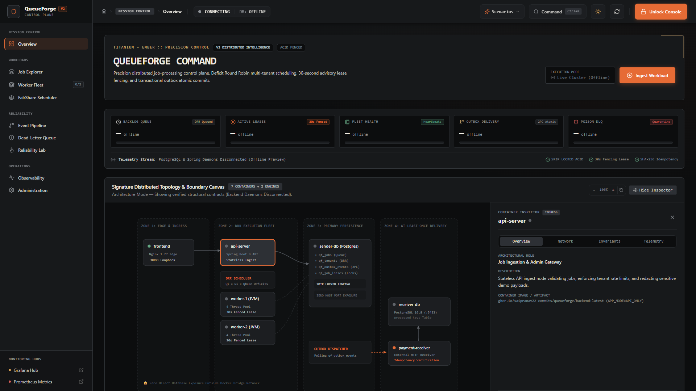
*Figure 1: Mission Control Desktop Overview — Live Cluster (Offline) status, throughput telemetry, and distributed subsystems.*

</div>

<br/>

<div align="center">

| Signature Architecture Topology | Worker Fleet & Fenced Leases |
| :---: | :---: |
| 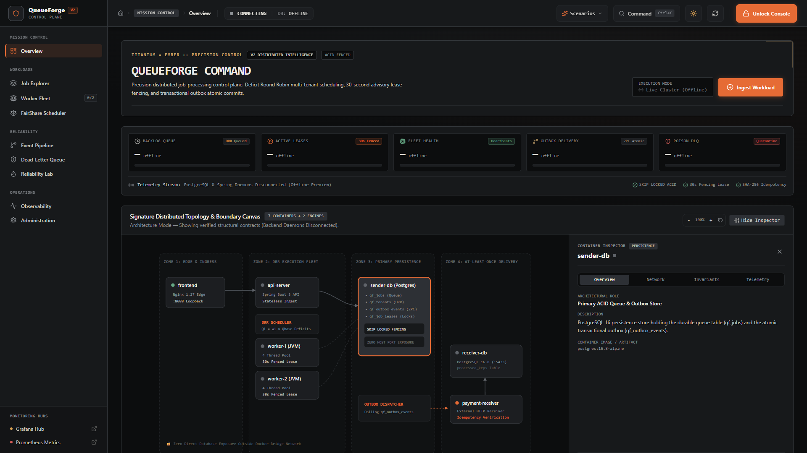 | 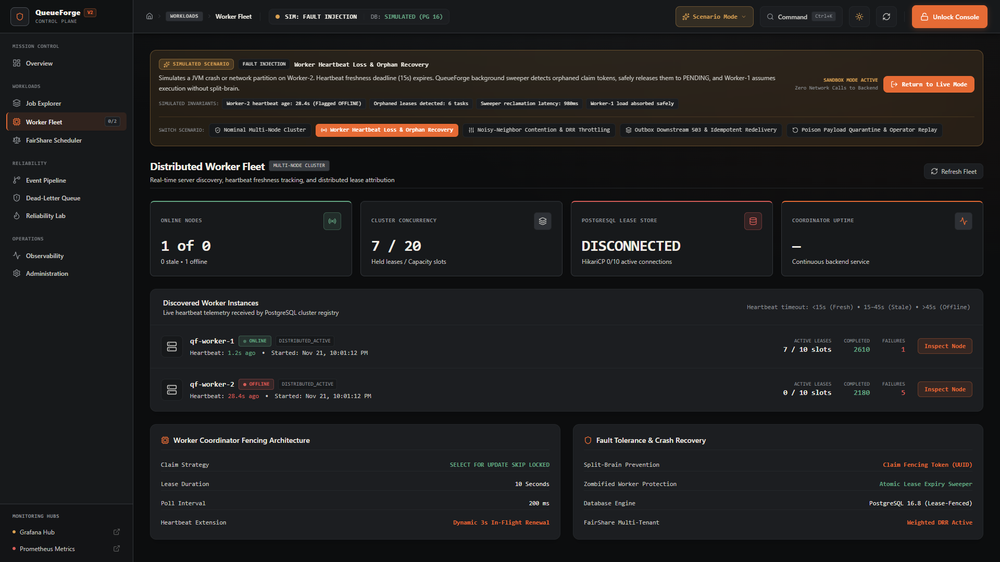 |
| *Figure 2: Interactive 7-service system topology inspector.* | *Figure 3: Multi-worker node heartbeats & lease tracking.* |

| FairShare DRR Scheduler Studio | Transactional Outbox Pipeline |
| :---: | :---: |
| 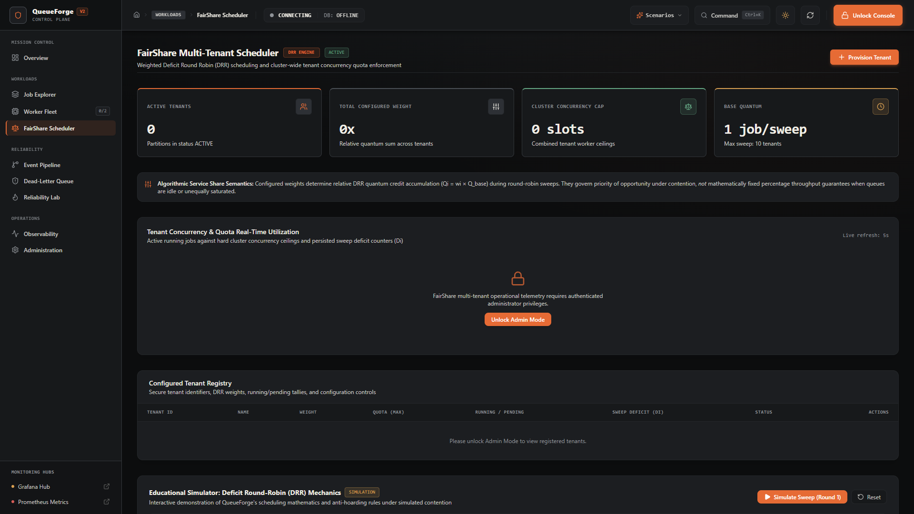 | 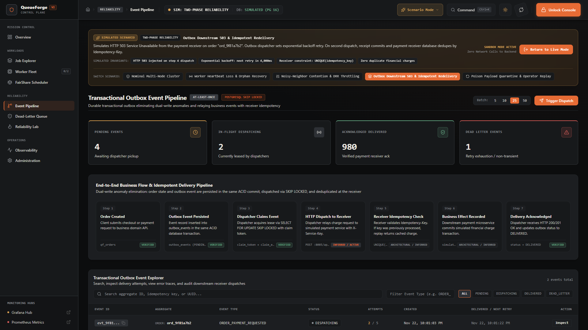 |
| *Figure 4: Deficit Round-Robin multi-tenant scheduling & quotas.* | *Figure 5: Atomic outbox events, HTTP dispatch & retry streams.* |

| Dead-Letter Queue & Authenticated Replay | Mobile Viewport (Responsive Command) |
| :---: | :---: |
| 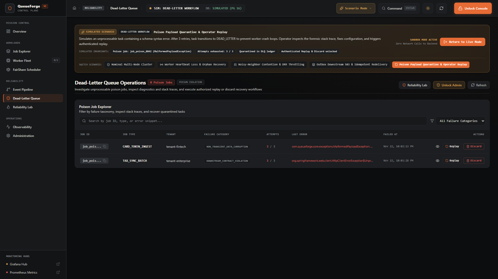 | 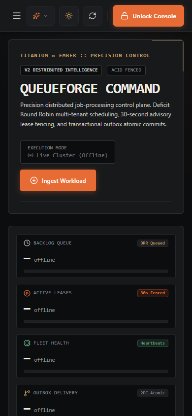 |
| *Figure 6: Failure classification, error stack traces & replay.* | *Figure 7: Responsive smartphone viewport (390×844).* |

</div>

---

## 3. Key Engineering Highlights

1. **Contention-Free Relational Queuing:** Eliminates message broker infrastructure and dual-write hazards using PostgreSQL 16's `SELECT FOR UPDATE SKIP LOCKED` inside atomic CTEs for non-blocking concurrent worker claims.
2. **Deficit Round Robin (DRR) FairShare Scheduler:** Prevents noisy-neighbor batch monopolization by enforcing cluster-wide tenant concurrency quotas (`max_concurrency`) and weighted round-robin quantum allocations.
3. **Verified 89.8% Latency Reduction:** Measured under a synthetic 1,080-job flood contention benchmark; cut quiet-tenant median wait times from **11,868 ms down to 1,210 ms**, raising Jain's Fairness Index to **1.000**.
4. **Dual-Fenced Lease Ownership:** Protects worker leases using a two-variable fencing token (`claim_token` UUID and monotonic `claim_version`). If a worker hangs past its 30s lease, a background sweeper reclaims the job, and the zombie worker is fenced out upon attempted completion.
5. **Transactional Outbox & Idempotent Consumer:** Guarantees atomic dual-write order persistence and outbox event logging in a single PostgreSQL transaction, dispatched via HTTP to an independent payment receiver microservice with primary-key deduplication and SHA-256 payload fingerprinting.
6. **Hardened Multi-Tenant & Demo Security:** Dual-mode authentication (constant-time `X-Admin-Key` verification via `MessageDigest.isEqual` and `HttpOnly` session cookies with CSRF defense), SHA-256 tenant key verifiers (Flyway V7), and an allowlisted Public Demo mode.
7. **Production Micro-Cluster Topology:** Containerized into a decoupled 7-service Docker Compose topology (`sender-db`, `receiver-db`, `api-server`, `worker-1`, `worker-2`, `payment-receiver`, `frontend`) bounded to ~2.4 GB aggregate memory with non-root security.
8. **100% Green CI Baseline:** Backed by **302 automated tests** (187 backend, 13 receiver, 82 Vitest, 20 Playwright browser tests) and 8 Docker smoke stages passing in GitHub Actions.

---

## 4. System Architecture

QueueForge V2 is deployed as a decoupled, multi-container micro-cluster partitioned across two isolated private Docker bridge networks:

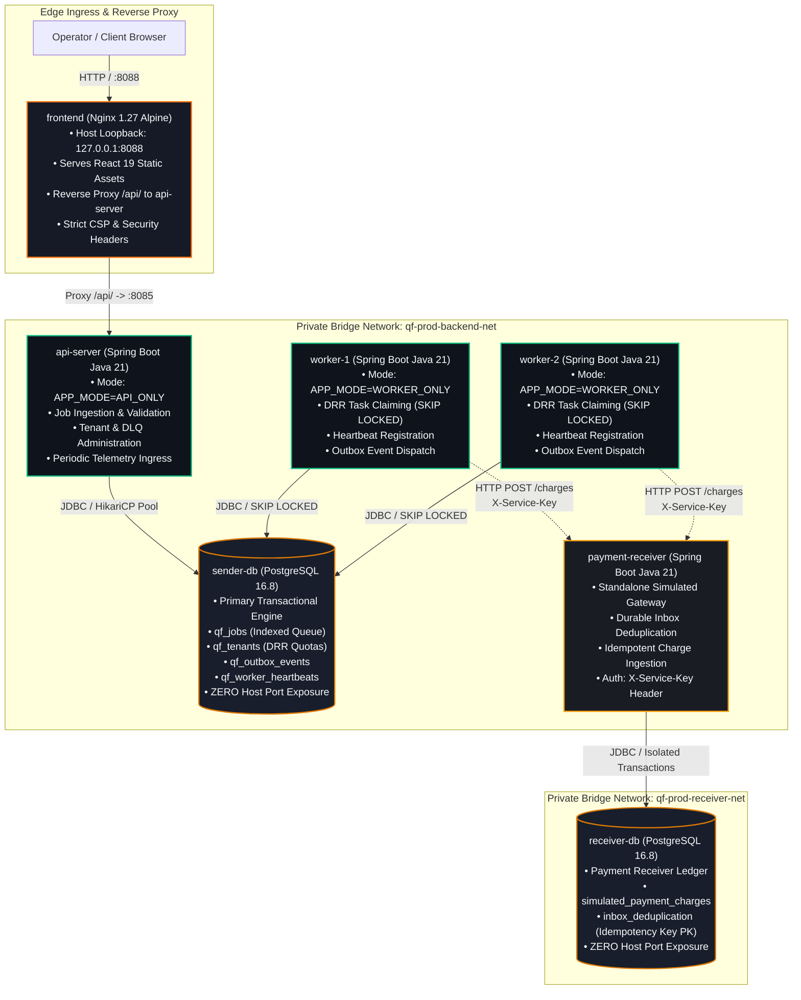

*For complete container specifications and network isolation guarantees, see the [Architecture Reference](docs/architecture/QUEUEFORGE_V2_ARCHITECTURE.md).*

---

## 5. Technology Stack

| Layer | Technologies Implemented | Verified Version |
| :--- | :--- | :---: |
| **Backend Application** | Java 21 LTS, Spring Boot 3, Spring Data JPA, Hibernate 6, HikariCP, Jackson | `3.3.5` / `21.0` |
| **Relational Storage** | PostgreSQL 16 Alpine, Flyway Database Migrations (V1–V8), Composite Indexes | `16.8` / `10.10` |
| **Frontend Control Plane**| React 19, TypeScript, Vite 6, Tailwind CSS 4, TanStack Query 5, Lucide Icons, Recharts | `19.3.1` / `6.0` |
| **Container & Proxy** | Docker Engine, Docker Compose, Nginx Alpine (Reverse Proxy & Security Headers) | `1.27-alpine` |
| **Test Automation** | JUnit 5, Testcontainers PostgreSQL, MockMvc, Vitest, React Testing Library, Playwright E2E | `1.65.1` (PW) |
| **CI/CD & Deployment** | GitHub Actions (7 verification jobs), Cloudflare Pages (Public Demo Hosting) | `v4` Actions |

---

## 6. Distributed Job Processing Lifecycle

Tasks move through a strictly validated state machine enforced by PostgreSQL row constraints and optimistic fencing tokens:

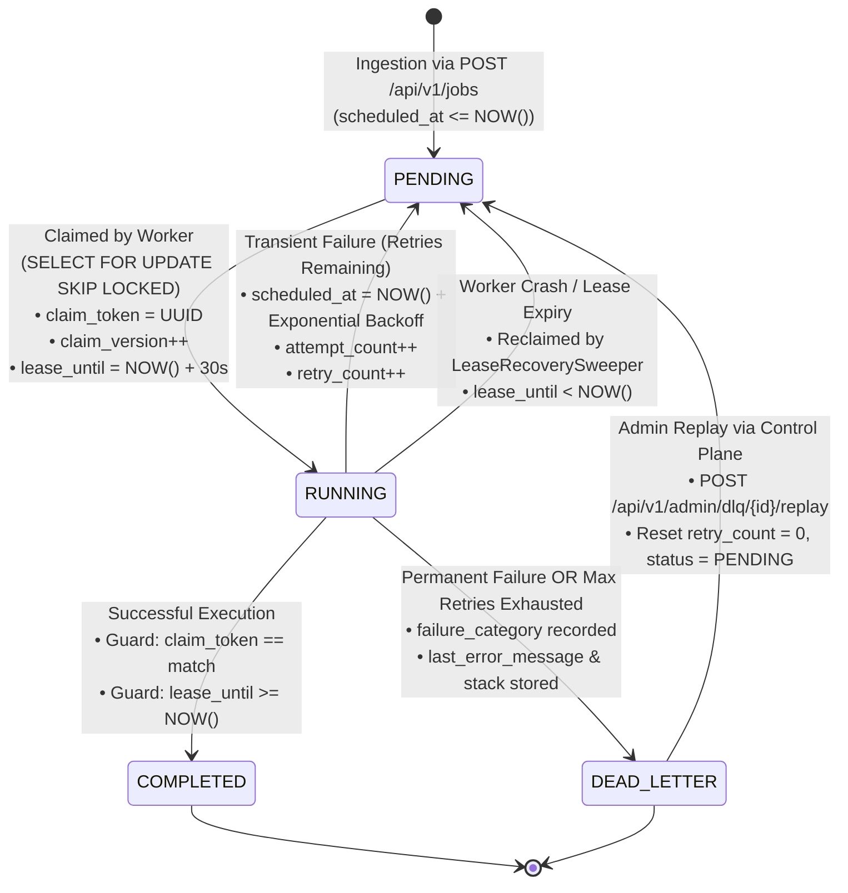

*For complete SQL claim queries, optimistic concurrency rules, and backoff formulas, see the [Job Lifecycle Specification](docs/architecture/QUEUEFORGE_JOB_LIFECYCLE.md).*

---

## 7. FairShare DRR Scheduler & Empirical Benchmark

In multi-tenant SaaS environments, a single batch tenant submitting 1,000 requests can monopolize worker capacity, forcing quiet interactive tenants to wait behind the flood. 

QueueForge implements **Deficit Round Robin (DRR)** fair queueing. During claim sweeps, candidate tenants are locked via `FOR UPDATE OF t` on `qf_tenants` to serialize multi-worker quota evaluations without oversubscribing tenant concurrency limits (`max_concurrency`). Each tenant receives quantum credits proportional to its weight, with anti-hoarding resets preventing idle tenants from hoarding historical credits.

### The Noisy-Neighbor Benchmark (Profile 3)
A controlled synthetic benchmark was executed comparing FairShare DRR against standard FIFO scheduling under an asymmetric synthetic workload:
- **Flood Tenant A:** Submitted 1,000 jobs simultaneously ($W=1$).
- **Quiet Tenants B, C, D, E:** Submitted 20 jobs each ($W=1$).
- **Total Workload:** 1,080 jobs under contention.

<div align="center">

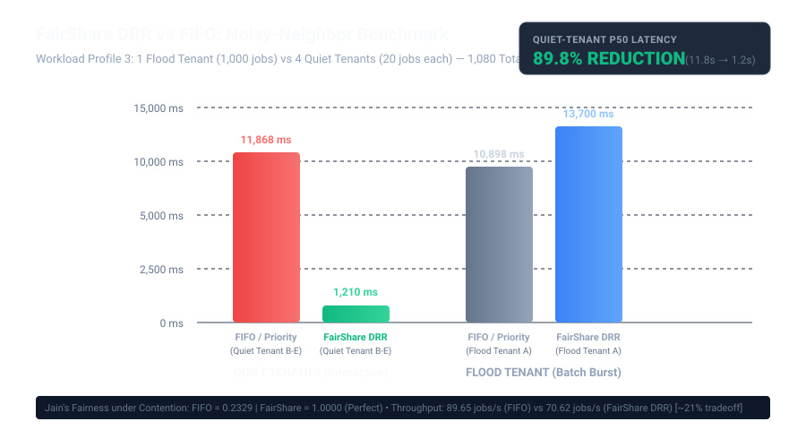

</div>

### Key Measured Results:
- **Quiet-Tenant Median Wait Time (p50):** Dropped from **11,868 ms down to 1,210 ms** — an **89.8% reduction in latency** ($1 - 1210/11868 = 89.804\%$).
- **Jain's Fairness Index Under Contention:** Surged from **0.2329** (severe starvation) to **1.0000** (perfect proportional sharing).
- **The Throughput Tradeoff:** FairShare introduces an observed aggregate throughput overhead of approximately **21%** (**89.65 jobs/sec in FIFO vs 70.62 jobs/sec in FairShare DRR**) due to row locking (`FOR UPDATE OF t`) and per-tenant round-robin evaluations. For low-latency interactive systems, trading 21% throughput for an 89.8% latency reduction is a deliberate and advantageous engineering tradeoff.

*Note: This benchmark result is specific to the documented synthetic 1,080-job flood contention workload. For full JSON datasets and measurement methodology, see the [Benchmark Presentation Report](docs/benchmark/FAIRSHARE_BENCHMARK_PRESENTATION.md).*

---

## 8. Transactional Outbox & Durable Receiver Idempotency

When coordinating with external services (such as credit card payment gateways), QueueForge avoids dual-write loss using the **Transactional Outbox Pattern**:

```mermaid
sequenceDiagram
    autonumber
    actor Client as Ingress Client / User
    participant OrderSvc as OrderService
    participant DB as Sender PostgreSQL (qf_orders, qf_outbox_events)
    participant Dispatcher as OutboxDispatcherScheduler
    participant Receiver as PaymentReceiverService
    participant RecDB as Receiver PostgreSQL (inbox_deduplication)

    rect rgb(20, 26, 38)
        Note over OrderSvc,DB: Step 1: Atomic Dual-Write in Single ACID Transaction
        Client->>OrderSvc: POST /api/v1/orders (orderNumber, amount, currency)
        OrderSvc->>DB: INSERT INTO qf_orders (status='CREATED')
        OrderSvc->>DB: INSERT INTO qf_outbox_events (idempotency_key, fingerprint, status='PENDING')
        DB-->>OrderSvc: Transaction Committed (Zero dual-write loss)
        OrderSvc-->>Client: 201 Created (Order Response)
    end

    rect rgb(30, 22, 16)
        Note over Dispatcher,RecDB: Step 2: At-Least-Once Dispatch & Durable Deduplication
        Dispatcher->>DB: SELECT * FROM qf_outbox_events WHERE status='PENDING' FOR UPDATE SKIP LOCKED
        DB-->>Dispatcher: OutboxEvent (idempotency_key, payload)
        Dispatcher->>Receiver: HTTP POST /api/v1/payments/charges<br/>Header: X-Service-Key, Idempotency-Key
        
        Receiver->>RecDB: SELECT * FROM inbox_deduplication WHERE idempotency_key = ?
        alt Fresh Key (First Time Seen)
            Receiver->>RecDB: INSERT INTO simulated_payment_charges (status='SUCCEEDED')
            Receiver->>RecDB: INSERT INTO inbox_deduplication (idempotency_key, fingerprint, response_payload)
            Receiver-->>Dispatcher: 201 Created (Fresh Charge)
        else Duplicate Key (Cached Outcome)
            Receiver->>Receiver: Compare inbound fingerprint with stored fingerprint
            Receiver-->>Dispatcher: 200 OK (idempotentReplay=true)
        end

        Dispatcher->>DB: UPDATE qf_outbox_events SET status='DELIVERED'<br/>UPDATE qf_orders SET status='PAID'
    end
```

### Invariants Enforced:
1. **Durable Primary Key Deduplication:** In `receiver-db`, table `inbox_deduplication` enforces `idempotency_key` as its **PRIMARY KEY**.
2. **Payload Conflict Detection:** If an existing key is presented with modified parameters (e.g., altered charge amounts), the receiver rejects the mutation with **HTTP 409 Conflict**.
3. **Lost-Acknowledgment Recovery:** If network connectivity drops after the receiver commits the charge but before the HTTP acknowledgment reaches the sender, subsequent retries resolve idempotently with **HTTP 200 OK**, returning the cached response with zero duplicate charges.

*For complete implementation code and concurrent race resolution, see the [Outbox Specification](docs/architecture/TRANSACTIONAL_OUTBOX_FLOW.md).*

---

## 9. Comprehensive Testing & CI Verification

QueueForge V2 is verified by **302 automated tests** and **8 Docker smoke stages**, executed across 7 parallel jobs in GitHub Actions:

| Test Suite | Framework / Tool | Test Count | Key Scenarios Verified |
| :--- | :--- | :---: | :--- |
| **Backend Integration** | JUnit 5, SpringBootTest, Testcontainers | **187 tests** | `SKIP LOCKED` claim races, lease expiry fencing, DRR starvation resistance, Flyway V8 heartbeats, multi-tenant quotas, 23 security tests. |
| **Payment Receiver** | JUnit 5, SpringBootTest, Real PostgreSQL | **13 tests** | Service auth (`X-Service-Key`), durable idempotency replay, payload conflict detection (409), concurrent insert race recovery. |
| **Frontend Unit/Component** | Vitest, React Testing Library, jsdom | **82 tests** | Admin unlock modal, CSRF token handling, DLQ tables, tenant quota meters, status badges, formatters, array defensive guards. |
| **Browser End-to-End** | Playwright (Desktop Chrome + Mobile Viewport) | **20 tests** | Mission Control rendering, status filters, execution timeline inspection, mobile navigation, Public Demo protections. |
| **Automated Test Total** | | **302 Tests** | **100% Pass Rate in Hosted CI** |
| **Docker Cluster Smoke** | PowerShell / Bash Smoke Engine | **8 stages** | End-to-end 7-container startup, Nginx reverse proxy ingress, multi-worker discovery, order creation, outbox dispatch. |

**Authoritative CI Reference:** [GitHub Actions Run 45041622474](https://github.com/saipranav22-commits/queueforge/actions/runs/45041622474) (7/7 Jobs Green on commit `ab0572a`).

---

## 10. Local Development & Quickstart

### Option A: Local Frontend Only (Low-Resource / Fast Preview)
To run the React 19 frontend locally (safe for machines with 8 GB RAM):
```bash
cd frontend
npm install
npm run dev -- --host 127.0.0.1
```
Open **`http://127.0.0.1:5173`** to access the control plane. Use the **Scenario Explorer** dropdown to demonstrate cluster behaviors with zero local backend processes.

### Option B: Full-Stack Docker Micro-Cluster
To launch the complete seven-service cluster locally using pre-configured Docker Compose:
```bash
git clone https://github.com/saipranav22-commits/queueforge.git
cd queueforge
cp .env.production.example .env.production

# Start the cluster with published GHCR images
docker compose -f docker-compose.prod.v2.yml -f docker-compose.prod.ghcr.yml up -d
```
Open **`http://127.0.0.1:8088`** to access the control plane through Nginx.  
- **Admin Unlock Key (Dev Default):** `dev_admin_secret_key_change_in_production`  
- **Backend API Health Probe:** `http://127.0.0.1:8088/api/v1/system/health`  

---

## 11. Security & Operational Hardening

- **Zero Plaintext Database Credentials:** Flyway V7 migrated all tenant credentials to SHA-256 verifiers (`api_key_hash`) with display-safe 8-character prefixes (`api_key_prefix`).
- **Constant-Time Verification:** All secret comparisons (`X-Admin-Key`, `X-Service-Key`, CSRF tokens) utilize `MessageDigest.isEqual` to eliminate side-channel timing attacks.
- **Dual-Mode Admin Security:** Automated clients authenticate via `X-Admin-Key`; interactive operators authenticate via `HttpOnly`, `SameSite=Lax` cookies with strict per-session CSRF token validation on mutating HTTP methods.
- **Hermetic Public Demo Mode:** Strict path allowlisting (`DEMO_ALLOWED_EXACT_PATHS`) allows anonymous monitoring while mathematically blocking access to raw payloads, stack traces, and state mutation.
- **Container Network Isolation:** Neither PostgreSQL instance (`sender-db`, `receiver-db`) binds port 5432 to the host network; the reverse proxy binds strictly to `127.0.0.1:8088` on the loopback interface.

---

## 12. Recruiter & Technical Portfolio Index

The repository maintains source-verified documentation across architecture, distributed systems correctness, and portfolio preparation:

| Topic / Focus | Document Link | Description |
| :--- | :--- | :--- |
| **Resume Bullets** | [QUEUEFORGE_RESUME_BULLETS.md](docs/portfolio/QUEUEFORGE_RESUME_BULLETS.md) | ATS-friendly, quantifiable experience bullets mapped to source code lines. |
| **Interview Deep Dive** | [QUEUEFORGE_INTERVIEW_EXPLANATION.md](docs/portfolio/QUEUEFORGE_INTERVIEW_EXPLANATION.md) | 2-minute pitch, 5 deep-dive technical questions, tradeoffs, and 100x scale roadmap. |
| **LinkedIn Project Copy** | [QUEUEFORGE_LINKEDIN_PROJECT_DESCRIPTION.md](docs/portfolio/QUEUEFORGE_LINKEDIN_PROJECT_DESCRIPTION.md) | Technical project summary for LinkedIn and developer portfolio pages. |
| **Cluster Architecture** | [QUEUEFORGE_V2_ARCHITECTURE.md](docs/architecture/QUEUEFORGE_V2_ARCHITECTURE.md) | Detailed 7-service topology, container boundaries, and networking. |
| **Job Lifecycle & Leases** | [QUEUEFORGE_JOB_LIFECYCLE.md](docs/architecture/QUEUEFORGE_JOB_LIFECYCLE.md) | Invariants, `SKIP LOCKED` queries, lease fencing, and backoff math. |
| **Transactional Outbox** | [TRANSACTIONAL_OUTBOX_FLOW.md](docs/architecture/TRANSACTIONAL_OUTBOX_FLOW.md) | Dual-write atomicity, receiver deduplication, and lost-ack recovery. |
| **Performance Benchmark** | [FAIRSHARE_BENCHMARK_PRESENTATION.md](docs/benchmark/FAIRSHARE_BENCHMARK_PRESENTATION.md) | 4-profile benchmark dataset, 89.8% latency proof, and tradeoffs. |
| **Video Walkthrough Script**| [QUEUEFORGE_FINAL_VIDEO_SCRIPT.md](docs/portfolio/QUEUEFORGE_FINAL_VIDEO_SCRIPT.md) | Exact 7-scene technical walkthrough narration script and visual cues. |

---

## 13. Project Status & Portfolio Notice

**Public Showcase:** [https://queueforge.pages.dev](https://queueforge.pages.dev) (Hosted on Cloudflare Pages).  
**Full-Stack Engine:** Verified in GitHub Actions CI with 302 automated tests and 8 Docker smoke stages. Pre-provisioned for containerized deployment.

*QueueForge is an open-source distributed systems and portfolio project created to demonstrate advanced backend engineering, concurrent relational queuing, and multi-tenant scheduling. All payment processing is simulated with synthetic data.*

---

## License

QueueForge is open-source software licensed under the [MIT License](LICENSE).
