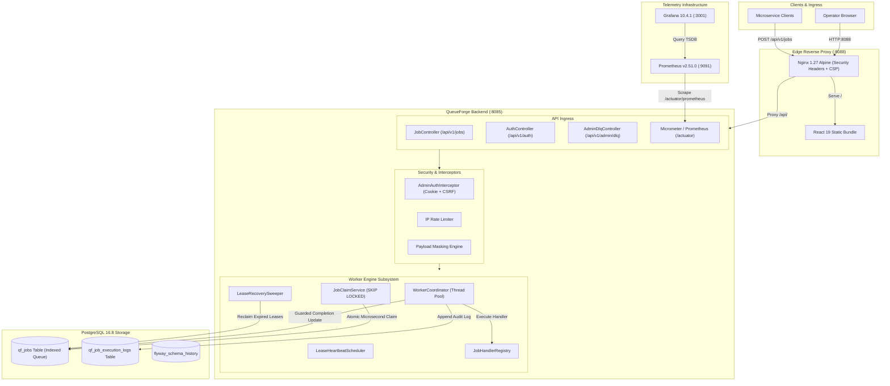
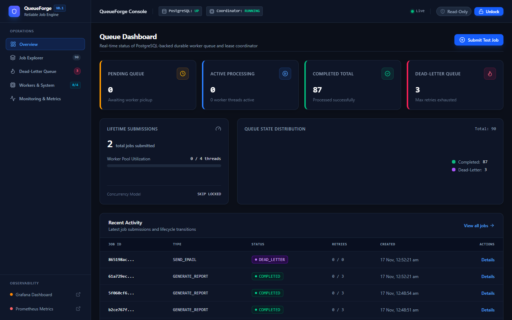
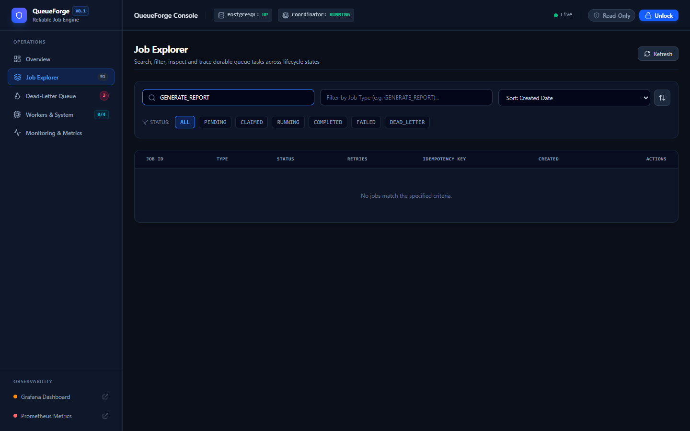
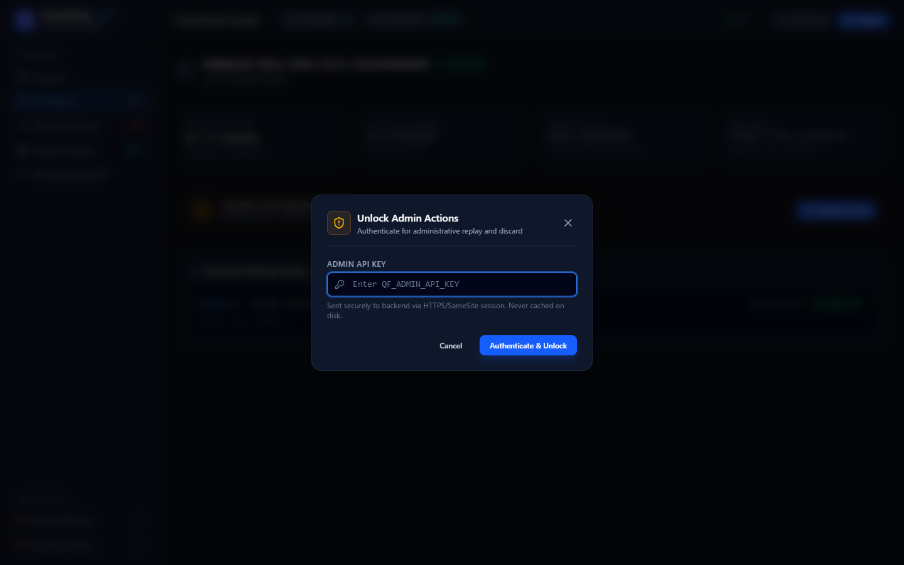
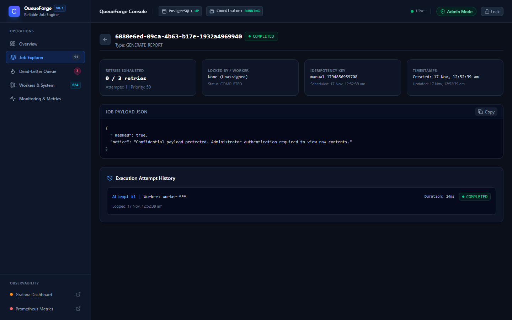
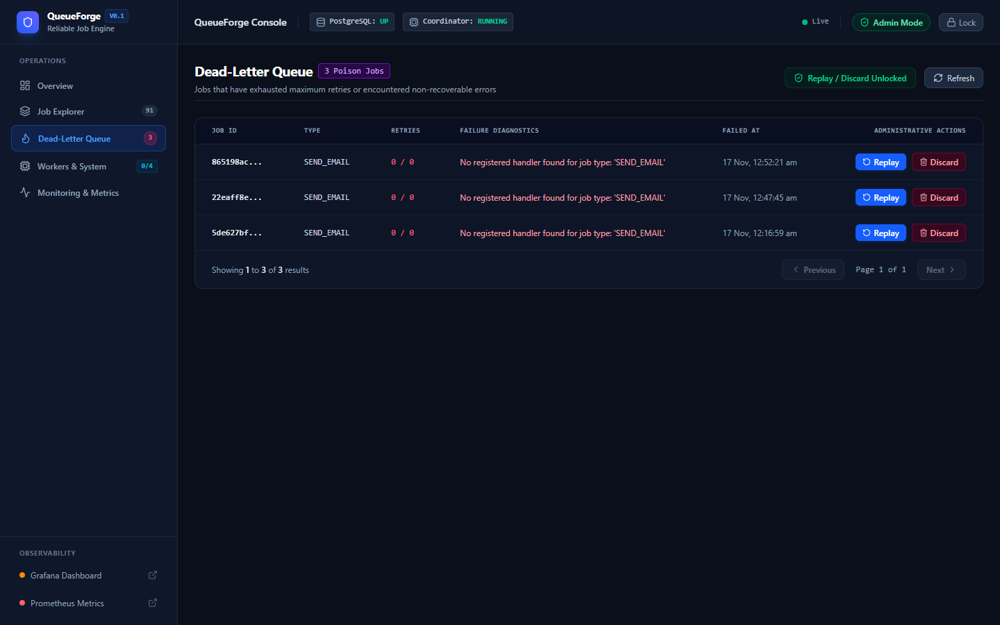
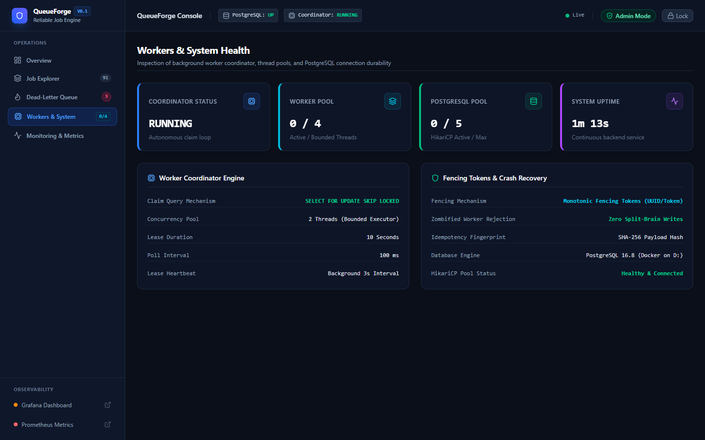
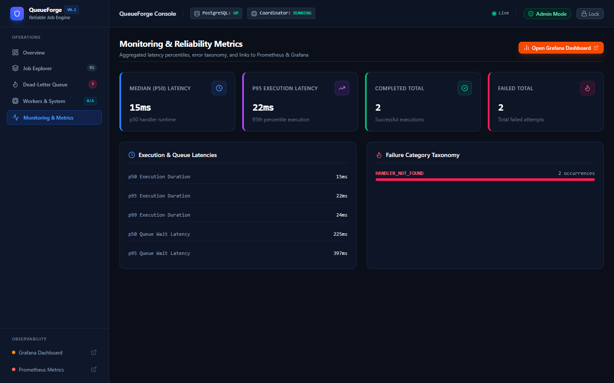
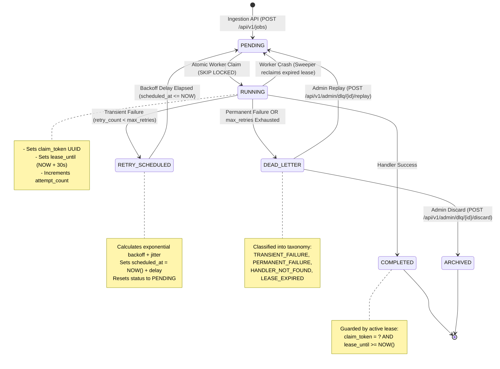

# QueueForge — Resilient Distributed Task Queue & Operations Console

[](https://github.com/saipranav22-commits/queueforge/actions/workflows/ci.yml)
[](https://github.com/saipranav22-commits/queueforge/actions)
[](https://openjdk.org/)
[](https://spring.io/projects/spring-boot)
[](https://www.postgresql.org/)
[](https://react.dev/)
[](https://www.docker.com/)
[](https://opensource.org/licenses/MIT)

QueueForge is a transactional, guaranteed-delivery asynchronous task execution platform and operations console engineered with **Java 21**, **Spring Boot 3**, **PostgreSQL 16**, and **React 19**. 

### 🚀 What's New in QueueForge V2 (Release Candidate)
- **Multi-Instance Worker Topology**: Support for decoupled `API_ONLY`, `WORKER_ONLY`, and `COMBINED` node operational modes across independent OS processes and containers.
- **FairShare Multi-Tenant Scheduler**: Deficit Round Robin (DRR) fair scheduling with cluster-wide concurrency quotas, slashing quiet-tenant starvation latency by **89.8%** under noisy-neighbor flood workloads.
- **Dual-Fenced Crash Recovery**: Cryptographic claim tokens and heartbeat lease fencing preventing zombie worker split-brain writes with zero quota leaks.
- **Transactional Outbox & Idempotent Consumer**: Cross-service at-least-once HTTP delivery with consumer-side deduplication guaranteeing exactly-one durable business effect under network ACK failures.
- **QueueForge ChaosLab**: Automated reproducible fault-injection harness for cross-process crash testing, network drop simulations, and lease recovery verification.
- **Enterprise Credential Hardening**: SHA-256 tenant API key hashing (Flyway V7), constant-time token comparisons, and production startup release gates.

---

## V1 vs V2 Architectural Comparison

| Capability | QueueForge V1 | QueueForge V2 (Release Candidate) |
| :--- | :--- | :--- |
| **Worker Topology** | Single combined JVM process | Independent multi-instance worker JVMs (`API_ONLY`, `WORKER_ONLY`) |
| **Multi-Tenancy** | Global shared FIFO / static priority | **FairShare Deficit Round Robin (DRR)** with per-tenant queues |
| **Concurrency Quotas** | None (unbounded tenant claims) | **Cluster-wide tenant quotas** (`max_concurrency`) enforced via row locks |
| **Noisy-Neighbor Defense** | Susceptible to batch monopolization | **89.8% p50 latency reduction** for quiet interactive tenants |
| **Cross-Service Consistency** | Local DB transactions only | **Transactional Outbox** with independent payment receiver & deduplication |
| **Fault Verification** | Manual fault testing | **ChaosLab automated harness** (barrier waits, crash injection, dropped ACKs) |
| **Credential Storage** | Plaintext API keys | **SHA-256 cryptographic verifiers** (`api_key_hash`) with constant-time equality |
| **Automated Test Coverage** | 82 backend tests | **164 backend + 13 receiver + 44 frontend + 8 smoke + 20 Playwright tests (100% Green)** | 

It eliminates the operational complexity and dual-write inconsistency of external message brokers for workloads requiring ACID durability, priority-aware scheduling, contention-free worker claiming via PostgreSQL row-level lock skipping (`SELECT FOR UPDATE SKIP LOCKED`), cryptographic lease fencing, automated crash recovery, exponential backoff with full jitter, and an authenticated administrative Dead-Letter Queue (DLQ) operations console.

---

## Table of Contents

- [1. The Engineering Problem](#1-the-engineering-problem)
- [2. System Architecture](#2-system-architecture)
- [3. Key Backend Capabilities](#3-key-backend-capabilities)
- [4. Technology Stack](#4-technology-stack)
- [5. Visual Tour & Screenshots](#5-visual-tour--screenshots)
- [6. Job Processing Lifecycle](#6-job-processing-lifecycle)
- [7. Deep-Dive: PostgreSQL SKIP LOCKED Concurrency](#7-deep-dive-postgresql-skip-locked-concurrency)
- [8. Deep-Dive: Lease Fencing & Crash Recovery](#8-deep-dive-lease-fencing--crash-recovery)
- [9. Deep-Dive: Retry Engine & Dead-Letter Queue (DLQ)](#9-deep-dive-retry-engine--dead-letter-queue-dlq)
- [10. Deep-Dive: Idempotency Guarantees & Constraints](#10-deep-dive-idempotency-guarantees--constraints)
- [11. Quickstart & Local Docker Startup](#11-quickstart--local-docker-startup)
- [12. REST API Reference & Examples](#12-rest-api-reference--examples)
- [13. Testing & Verification Suite](#13-testing--verification-suite)
- [14. Observability, Metrics & Telemetry](#14-observability-metrics--telemetry)
- [15. Verified Local Performance Benchmark](#15-verified-local-performance-benchmark)
- [16. Security & Deployment Limitations](#16-security--deployment-limitations)
- [17. Roadmap & Future Improvements](#17-roadmap--future-improvements)

---

## 1. The Engineering Problem

Modern web architectures routinely require asynchronous background processing—generating invoices, sending emails, processing webhooks, and recalculating search indices. 

Common approaches present severe architectural trade-offs:
1. **In-Memory Executors (e.g., Spring `@Async`):** Vulnerable to process restarts; server reboots wipe in-flight jobs silently.
2. **External Message Brokers (RabbitMQ, Kafka, Celery):** Introduce the **Dual-Write Hazard**. If a business transaction commits in the database but the network write to the broker fails, the event is permanently lost. Implementing the 2-Phase Commit (2PC) or an external Transactional Outbox adds significant operational overhead.
3. **Naive Relational Queues (`SELECT ... FOR UPDATE`):** Cause row contention, table lock escalation, and deadlocks when concurrent worker threads query the head of the queue.

**QueueForge's Solution:** Leverages PostgreSQL as the ACID-compliant queue. Job ingestion participates in the exact same database transaction as the business entity update. Using PostgreSQL 16's `SKIP LOCKED`, concurrent workers claim jobs without lock waiting, providing transactionally safe at-least-once execution with zero external broker infrastructure.

---

## 2. System Architecture



---

## 3. Key Backend Capabilities

- **Non-Blocking Concurrency via SKIP LOCKED:** Workers claim jobs using row-level lock skipping, avoiding serialization blocks and table-level locks across concurrent workers.
- **Dual Fencing (Claim Tokens + Temporal Leases):** Prevents "zombie worker" split-brain writes. Every claim assigns a unique `claim_token` UUID; completions require `claim_token = ? AND lease_until >= NOW()`.
- **Decoupled Claim & Execution:** Database locks are held strictly during the microsecond status transition and released before business logic executes in a bounded thread pool, preserving HikariCP connection availability.
- **Exponential Backoff with Full Jitter:** Retries scale as $\text{initialDelay} \times \text{multiplier}^{r-1}$ randomized across $\pm 20\%$ jitter to protect downstream systems from thundering herds.
- **Explicit Error Classification Taxonomy:** Differentiates `TRANSIENT_FAILURE` (retried with backoff), `PERMANENT_FAILURE` (immediate DLQ), `HANDLER_NOT_FOUND` (immediate DLQ), and `LEASE_EXPIRED`.
- **Deterministic Idempotency:** SHA-256 canonical payload hashing coupled with unique constraints rejects duplicate concurrent submissions with HTTP 409 Conflict.
- **Administrative Dead-Letter Management:** Authenticated endpoints for paginated DLQ inspection, single-job diagnostic drilldowns, atomic replay (resetting to `PENDING`), and audit-compliant discard (archival without hard delete).
- **Dual-Mode Security Boundaries:** Public endpoints mask confidential payloads (`_masked: true`). Operators unlock administrative privileges via `HttpOnly` session cookies and double-submit cryptographic CSRF tokens.
- **Observability:** Prometheus metric exporter with an aggregated 1-second queue gauge cache that prevents database query overload on metric scrapes.

---

## 4. Technology Stack

| Layer | Technologies |
| :--- | :--- |
| **Backend Runtime** | Java 21 LTS (Eclipse Temurin), Spring Boot 3.3.5 |
| **Persistence & Migrations** | PostgreSQL 16.8, Spring Data JPA, Hibernate 6.5, HikariCP, Flyway 10 |
| **Frontend Framework** | React 19, TypeScript 5, Vite 6, React Router 7, TanStack Query v5 |
| **UI Design System** | Tailwind CSS v4, Lucide React icons, Recharts |
| **Packaging & Ingress** | Docker Engine, Multi-Stage Dockerfiles, Nginx 1.27 Alpine |
| **Observability & Telemetry**| Spring Boot Actuator, Micrometer, Prometheus v2.51.0, Grafana 10.4.1 |
| **Testing & Quality** | JUnit 5, Mockito, Testcontainers, Vitest, Testing Library, Playwright (Edge) |

---

## 5. Visual Tour & Screenshots

### Operations Console Overview
Real-time KPI metrics, worker pool thread utilization, queue state distribution, and test job submission.


### Job Explorer with Multi-Criteria Filtering
Paginated table of jobs with live status filtering, job type search, and sorting.


### Sensitive Field Masking & Admin Unlock
Unauthenticated viewers see masked confidential parameters. Unlocking triggers secure authentication.


### Unlocked Job Diagnostics & Execution History
Authenticated view displaying full unmasked payload, attempt counters, claim tokens, and execution timeline.


### Dead-Letter Queue (DLQ) & Error Taxonomy
Review exhausted and permanently failed jobs with error classifications, stack traces, and atomic Replay/Discard actions.


### Workers & Database Connection Pool Health
Monitor coordinator status, configured concurrency, active worker threads, and HikariCP connection health.


### Metrics, Latency Percentiles & Grafana Integration
Execution duration percentiles (p50, p95, p99), queue wait times, and direct deep-links to Prometheus and Grafana.


---

## 6. Job Processing Lifecycle



---

## 7. Deep-Dive: PostgreSQL SKIP LOCKED Concurrency

Traditional relational queues using `SELECT ... FOR UPDATE` serialize all worker threads on the first row of the queue, causing lock contention, deadlocks, and connection timeouts.

QueueForge implements row-level lock skipping:
```sql
UPDATE qf_jobs
SET 
    status = 'RUNNING',
    locked_by = :workerId,
    claim_token = :claimToken,
    claim_version = claim_version + 1,
    lease_until = CURRENT_TIMESTAMP + (:leaseSeconds * INTERVAL '1 second'),
    attempt_count = attempt_count + 1,
    retry_count = CASE WHEN attempt_count = 0 THEN 0 ELSE retry_count + 1 END,
    updated_at = CURRENT_TIMESTAMP
WHERE id IN (
    SELECT id
    FROM qf_jobs
    WHERE status = 'PENDING'
      AND scheduled_at <= CURRENT_TIMESTAMP
    ORDER BY priority DESC, scheduled_at ASC
    LIMIT :batchSize
    FOR UPDATE SKIP LOCKED
)
RETURNING *;
```

**How It Works:**
1. Worker 1 queries the queue: row 1 is locked.
2. Worker 2 queries concurrently: instead of waiting for Worker 1 to commit, it **skips** row 1 instantly and locks row 2.
3. The claim transaction commits in under 5 milliseconds. The row lock is released, and the worker executes business logic in JVM user-space without holding a database transaction.

---

## 8. Deep-Dive: Lease Fencing & Crash Recovery

### The "Zombie Worker" Hazard
In distributed systems, a worker thread may experience an unexpected pause (e.g., long garbage collection pause, network freeze). If its lease expires while paused, another worker reclaims the job. If the paused worker later revives, it might attempt to write its result, overwriting the new worker's state.

### QueueForge's Dual Fencing Defense
All mutating state transitions (`completeJob`, `failJob`, `extendLease`) enforce atomic fencing:
```sql
UPDATE qf_jobs
SET status = 'COMPLETED',
    completed_at = CURRENT_TIMESTAMP,
    updated_at = CURRENT_TIMESTAMP
WHERE id = :jobId
  AND status = 'RUNNING'
  AND claim_token = :claimToken
  AND (lease_until IS NULL OR lease_until >= CURRENT_TIMESTAMP);
```
- If the lease expired and the job was reassigned, `claim_token` has changed.
- The update matches **0 rows**, the write is aborted, and the zombie worker throws a fencing exception without corrupting database state.

### Automated Lease Recovery Sweeper
A dedicated background daemon (`LeaseRecoverySweeper`) evaluates orphaned rows every 5 seconds:
- If a crashed worker abandoned a job and `retry_count < max_retries`, the job is returned to `PENDING` with `locked_by = NULL` and `claim_token = NULL`.
- If the retry budget is exhausted, the job is routed to `DEAD_LETTER` with `failure_category = LEASE_EXPIRED`.

---

## 9. Deep-Dive: Retry Engine & Dead-Letter Queue (DLQ)

### Exponential Backoff with Full Jitter Formula
$$\text{Nominal Delay}(r) = \min\left(\text{maxDelay},\ \text{initialDelay} \times \text{multiplier}^{r-1}\right)$$
$$\text{Jitter} = \text{Nominal Delay} \times \text{jitterFactor} \times \text{random}(-1.0,\ +1.0)$$
$$\text{Final Delay} = \max(1,\ \text{round}(\text{Nominal Delay} + \text{Jitter}))$$

*Defaults: `initialDelay = 5s`, `multiplier = 3.0`, `maxDelay = 3600s`, `jitterFactor = 0.20` ($\pm 20\%$).*

### Error Classification Taxonomy
| Category | Condition | Handling |
| :--- | :--- | :--- |
| `TRANSIENT_FAILURE` | Network timeout, database lock acquisition timeout, 503 error | Retried with exponential backoff until `retry_count >= max_retries`, then transitioned to `DEAD_LETTER`. |
| `PERMANENT_FAILURE` | Invalid payload schema, domain validation failure, 4xx error | Immediately routed to `DEAD_LETTER` without wasting retry quota. |
| `HANDLER_NOT_FOUND` | No registered handler for job type | Immediately routed to `DEAD_LETTER`. |
| `LEASE_EXPIRED` | Worker crashed or abandoned job execution | Sweeper reclaims to `PENDING` or `DEAD_LETTER` if retry budget exhausted. |

---

## 10. Deep-Dive: Idempotency Guarantees & Constraints

1. **SHA-256 Fingerprinting:** On job submission, the request payload is normalized into canonical JSON and hashed using SHA-256.
2. **Deterministic Deduplication:** If an `Idempotency-Key` header is supplied, a unique database constraint (`qf_jobs_idempotency_key_uq`) prevents duplicate inserts.
3. **Conflict Detection (HTTP 409):** If a client resubmits an existing `Idempotency-Key` with a **different payload**, QueueForge rejects the request with HTTP 409 Conflict, preventing accidental payload tampering.
4. **Guaranteed At-Least-Once Delivery:** Handlers should be designed to be idempotent (e.g., natural database keys, payment transaction reference checks) in the rare event of a worker crash after business execution but prior to completion acknowledgment.

---

## 11. Quickstart & Local Docker Startup

### Prerequisites
- Docker Engine 26+ and Docker Compose v2.20+
- Git

### 1. Clone & Configure Environment
```bash
git clone https://github.com/saipranav22-commits/queueforge.git
cd queueforge

# Copy production environment configuration template
cp .env.production.example .env.production
```

### 2. Launch Container Stack
```bash
# Launch full-stack 7-service QueueForge V2 topology\ndocker compose -f docker-compose.v2.yml up -d
```

### 3. Verify Health & Running Services
```bash
docker compose -p queueforge-prod -f docker-compose.prod.yml ps
```

The stack initializes in dependency order:
- `queueforge-prod-postgres`: PostgreSQL 16 on internal port 5432
- `queueforge-prod-backend`: Spring Boot 3 running Flyway migrations on port 8085
- `queueforge-prod-frontend`: Nginx reverse proxy serving React SPA on [http://127.0.0.1:8088/](http://127.0.0.1:8088/)
- `queueforge-prod-prometheus`: Metrics scraper on [http://127.0.0.1:9091/](http://127.0.0.1:9091/)
- `queueforge-prod-grafana`: Telemetry dashboard on [http://127.0.0.1:3001/](http://127.0.0.1:3001/)

---

## 12. REST API Reference & Examples

### Public Endpoints

#### Submit a New Asynchronous Job
```bash
curl -X POST http://127.0.0.1:8088/api/v1/jobs \
  -H "Content-Type: application/json" \
  -H "Idempotency-Key: invoice-job-984321" \
  -d '{
    "jobType": "GENERATE_REPORT",
    "payload": {
      "reportName": "q4-financial-audit",
      "format": "PDF"
    },
    "priority": 80,
    "maxRetries": 3,
    "delaySeconds": 0
  }'
```
*Response (HTTP 202 Accepted):*
```json
{
  "jobId": "e4b1c812-7634-4bc2-b361-9f24e6a8d790",
  "status": "PENDING",
  "createdAt": "2026-11-17T07:29:18.824Z",
  "scheduledAt": "2026-11-17T07:29:18.824Z"
}
```

#### Query Job Status
```bash
curl http://127.0.0.1:8088/api/v1/jobs/e4b1c812-7634-4bc2-b361-9f24e6a8d790
```
*Response (HTTP 200 OK):*
```json
{
  "jobId": "e4b1c812-7634-4bc2-b361-9f24e6a8d790",
  "jobType": "GENERATE_REPORT",
  "status": "COMPLETED",
  "priority": 80,
  "attemptCount": 1,
  "retryCount": 0,
  "maxRetries": 3,
  "scheduledAt": "2026-11-17T07:29:18.824Z",
  "createdAt": "2026-11-17T07:29:18.824Z",
  "completedAt": "2026-11-17T07:29:19.976Z"
}
```

---

### Protected Administrative Endpoints

#### Authenticate Administrator Session
```bash
curl -i -X POST http://127.0.0.1:8088/api/v1/auth/login \
  -H "Content-Type: application/json" \
  -d '{ "adminKey": "qf_prod_admin_key_super_secret_64_characters_long_2026" }'
```
*Sets `Set-Cookie: QF_SESSION=...; Path=/api/v1; HttpOnly; SameSite=Lax` and returns CSRF token.*

#### Replay Dead-Letter Job
```bash
curl -X POST http://127.0.0.1:8088/api/v1/admin/dlq/{jobId}/replay \
  -b "QF_SESSION=<session_token>" \
  -H "X-CSRF-Token: <csrf_token>"
```
*Resets job status back to `PENDING` and schedules it for immediate worker claim.*

---

## 13. Testing & Verification Suite

QueueForge is governed by an automated, multi-tiered regression verification matrix executed under GitHub Actions cloud CI across 6 parallel jobs:

| Test Layer | Framework / Tools | Scope & Capabilities Verified | Verified Pass Count |
| :--- | :--- | :--- | :--- |
| **Backend Integration** | JUnit 5, Spring Boot Test, Testcontainers | ACID queue, SKIP LOCKED concurrency, FairShare DRR, claim tokens, dual-fencing, lease recovery, transactional outbox | **164 Tests Passed** |
| **Payment Receiver** | JUnit 5, Spring Boot Test | Pre-shared service key authentication, idempotent charge deduplication, SHA-256 fingerprint hashing | **13 Tests Passed** |
| **Frontend Components** | Vitest, Testing Library, React 19 | Obsidian Pulse components, theme context, command palette, pagination, metrics cards, admin unlock modal | **44 Tests Passed** |
| **Docker Build Matrix** | Docker Buildx Multi-Stage | Independent image compilation for backend, payment receiver, and frontend | **3 Images Verified** |
| **Cluster Smoke Test** | Bash, Docker Compose, Curl | 7-service multi-worker cluster: Nginx health, admin auth, tenant provisioning, worker attribution, outbox relay | **8 Stages Passed** |
| **Browser E2E** | Playwright (Desktop & Mobile) | Real Chromium headless browser: login, dashboard stream, job filtering, fleet heartbeats, FairShare analytics | **20 Tests Passed** |
| **Total Test Suite** | **Complete Full-Stack Cloud CI** | **Verified in GitHub Actions Hosted CI (Run 44621653433)** | **100% GREEN** |

### Running Tests Locally

#### Backend Core Tests
`ash
cd backend
mvn clean test
`

#### Simulated Payment Receiver Tests
`ash
cd simulated-payment-receiver
mvn clean test
`

#### Frontend Vitest Component Tests
`ash
cd frontend
npm test -- --run
`

#### Full-Stack Docker Smoke Test (Requires Docker)
`ash
./scripts/smoke-test-v2.sh
`

---

## 14. Observability, Metrics & Telemetry

QueueForge is instrumented for production-grade operational monitoring:

### Aggregated Queue Gauges
To eliminate database `COUNT(*)` overhead during Prometheus scraping, a background refresher updates queue metrics every second in a single `GROUP BY status` query:
- `queueforge_jobs_pending`: Total jobs awaiting execution.
- `queueforge_jobs_running`: Total jobs under active worker leases.
- `queueforge_jobs_completed`: Total successfully processed jobs.
- `queueforge_jobs_dead_letter`: Total jobs in Dead-Letter Queue.
- `queueforge_workers_active`: Active worker threads in the execution pool.

### Latency Percentiles & Counters
- `queueforge_job_execution_duration_seconds{job_type, status}`: Timer measuring execution latency with p50, p95, and p99 percentiles.
- `queueforge_job_queue_wait_duration_seconds{job_type}`: Timer measuring duration from submission to worker claim.
- `queueforge_jobs_retried_total`: Monotonic counter tracking retried jobs.
- `queueforge_jobs_failed_total{job_type, failure_category}`: Counter tracking failures categorized by error taxonomy.

---

## 15. Verified Local Performance Benchmark

Measured under controlled local burst workloads (Windows / WSL2 / Docker Desktop single-node environment):

- **Workload Batch:** 40 jobs submitted concurrently across priorities 1–100.
- **Worker Concurrency:** 4 worker threads.
- **Submission Throughput:** **25.33 jobs/second** (40 jobs ingested in 1.579s).
- **Processing Rate:** **19.43 jobs/second** (40 jobs claimed and completed in 2.059s).
- **Execution Latency:**
  - **p50 (Median):** **4.43 ms**
  - **p95:** **19.11 ms**
  - **p99:** **24.00 ms**
- **Queue Wait Duration (p50):** **722.25 ms**
- **Connection Pool:** 0 active / 6 idle connections (zero pool exhaustion).
- **JVM Resident Memory (RSS):** ~126.1 MB during peak load.

*(Note: This benchmark validates algorithmic correctness and lock-free execution under local concurrency. It is distinct from high-throughput distributed cloud benchmarks).*

---

## 16. Security & Deployment Limitations

1. **In-Memory Session Store:** Admin sessions and CSRF mappings reside in the backend JVM's in-memory cache (`ConcurrentHashMap`). In a horizontally scaled multi-replica cluster, session state must be backed by an external distributed cache (e.g., Redis).
2. **TLS Termination:** The internal Nginx container listens on HTTP port 80. Production deployments require an edge ingress terminator (Cloudflare, AWS ALB, Traefik, or reverse proxy) to terminate TLS, enforce HTTPS, and set `X-Forwarded-Proto: https`.
3. **Database Port Protection:** In `docker-compose.prod.yml`, PostgreSQL port 5432 and backend port 8085 have zero published host ports, preventing exposure outside the internal bridge network.
4. **Environment Secrets:** Never commit `.env.production` with live credentials to version control. Use a secret manager (AWS Secrets Manager, HashiCorp Vault, GitHub Secrets) for cloud environments.

---

## 17. Roadmap & Future Improvements

- [ ] **Distributed Session Store:** Redis-backed Spring Session implementation for seamless multi-node backend clustering.
- [ ] **Dynamic Queue Partitioning:** Worker thread assignment by job priority tiers (e.g., dedicated pool for High Priority vs. Bulk jobs).
- [ ] **OpenTelemetry Tracing:** Distributed trace propagation using W3C TraceContext across job submission, worker execution, and downstream API calls.
- [ ] **Webhook Push Notifications:** Automatic webhook dispatch to client endpoints on job completion or DLQ transition.
- [ ] **Scheduled Cron Jobs:** Periodic cron syntax scheduling for recurring background tasks.

---

## License

This project is licensed under the [MIT License](LICENSE).
