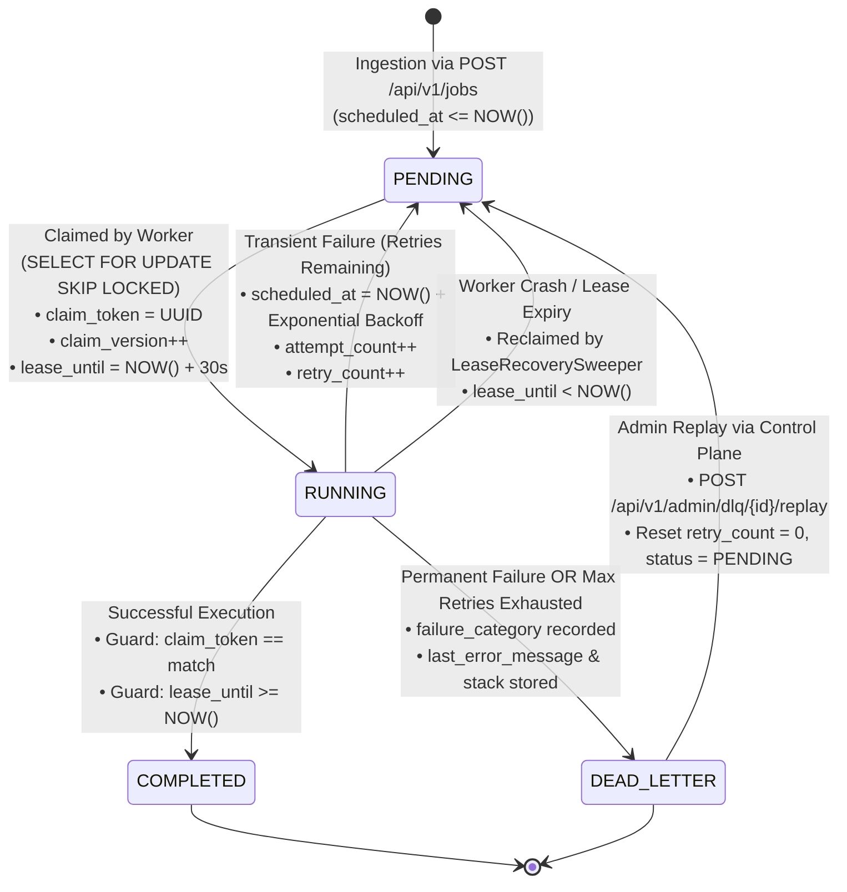

# QueueForge V2 — Distributed Job Lifecycle & State Machine

**Document Identifier:** `QF-ARCH-V2-LIFECYCLE`  
**Classification:** Distributed Concurrency Specification  
**Verified Source Reference:** [JobClaimService.java](..\..\backend\src\main\java\com\queueforge\service\JobClaimService.java), [BackoffCalculator.java](..\..\backend\src\main\java\com\queueforge\service\retry\BackoffCalculator.java)  

---

## 1. Formal Job State Machine

Every task in QueueForge transitions through a strictly bounded, deterministic state machine enforced by PostgreSQL row constraints and optimistic concurrency checks:



---

## 2. Ingestion & Queue Eligibility

1. **Client Submission:** Client issues `POST /api/v1/jobs` with payload, priority (1–100), max retries, and an optional `idempotency_key`.
2. **Persistence:** [JobController.java](..\..\backend\src\main\java\com\queueforge\api\controller\JobController.java) persists the entity into `qf_jobs`.
3. **Queue Eligibility Criteria:** A job becomes eligible for worker claiming when:
   $$\text{status} = \text{'PENDING'} \quad \text{AND} \quad \text{scheduled\_at} \le \text{CURRENT\_TIMESTAMP}$$
4. **Index Optimization:** Ingestion and polling are accelerated by partial composite index `idx_qf_jobs_tenant_claim_v2`:
   ```sql
   CREATE INDEX idx_qf_jobs_tenant_claim_v2 
   ON qf_jobs (tenant_id, priority DESC, scheduled_at ASC, id ASC) 
   WHERE status = 'PENDING';
   ```

---

## 3. Contention-Free Worker Claiming (`SKIP LOCKED`)

Workers query `qf_jobs` inside an atomic Common Table Expression (CTE) in [JobClaimService.java](..\..\backend\src\main\java\com\queueforge\service\JobClaimService.java#L85-L107):

```sql
WITH candidate_jobs AS (
    SELECT id
    FROM qf_jobs
    WHERE tenant_id = ?
      AND status = 'PENDING'
      AND scheduled_at <= CURRENT_TIMESTAMP
    ORDER BY priority DESC, scheduled_at ASC, id ASC
    LIMIT ?
    FOR UPDATE SKIP LOCKED
)
UPDATE qf_jobs j
SET status = 'RUNNING',
    claim_token = gen_random_uuid(),
    claim_version = claim_version + 1,
    locked_by = ?,
    lease_until = CURRENT_TIMESTAMP + (? * INTERVAL '1 second'),
    attempt_count = attempt_count + 1,
    retry_count = CASE WHEN attempt_count = 0 THEN 0 ELSE retry_count + 1 END,
    updated_at = CURRENT_TIMESTAMP
FROM candidate_jobs c
WHERE j.id = c.id
RETURNING j.id, j.claim_token, j.claim_version, j.job_type, j.payload, j.priority,
          j.attempt_count, j.retry_count, j.max_retries, j.scheduled_at, j.lease_until, j.locked_by, j.tenant_id;
```

### Key Concurrency Invariants:
- **Zero Lock Waiting:** `SKIP LOCKED` skips rows currently held by any other worker transaction, eliminating head-of-line blocking.
- **Atomic Transition:** The job moves from `PENDING` to `RUNNING` in the same statement, eliminating race conditions.
- **Fencing Tokens:** Generates a unique `claim_token` UUID and increments `claim_version`.

---

## 4. Fenced Completion & Zombie Defense

When a worker finishes executing a job, it calls `completeJob()` in [JobClaimService.java](..\..\backend\src\main\java\com\queueforge\service\JobClaimService.java#L358-L386):

```sql
UPDATE qf_jobs
SET status = 'COMPLETED',
    lease_until = NULL,
    locked_by = NULL,
    claim_token = NULL,
    completed_at = CURRENT_TIMESTAMP,
    updated_at = CURRENT_TIMESTAMP
WHERE id = ?
  AND status = 'RUNNING'
  AND claim_token = ?
  AND lease_until IS NOT NULL
  AND lease_until >= CURRENT_TIMESTAMP;
```

### Split-Brain Zombie Defense Scenario:
1. **Worker 1 claims Job A** (`claim_token = UUID_1`, `lease_until = T + 30s`).
2. **Worker 1 experiences a 40-second JVM pause** (e.g., stop-the-world GC, disk IO hang, or network partition).
3. **Lease Expires:** At $T + 31\text{s}$, `LeaseRecoverySweeper` detects `lease_until < NOW()` and reclaims Job A back to `PENDING`.
4. **Worker 2 claims Job A:** Receives `claim_token = UUID_2` and `lease_until = T + 61\text{s}`.
5. **Worker 1 Wakes Up:** Worker 1 resumes and attempts to mark Job A `COMPLETED` with `UUID_1`.
6. **Fencing Check Rejection:** The database update affects **0 rows** because `claim_token != UUID_1` (and `lease_until` has expired).
7. **Result:** Worker 1 detects `rowsUpdated == 0`, logs that it was fenced out, and discards its stale completion. The database remains perfectly consistent.

---

## 5. Failure Classification & Retry Backoff

When an exception occurs during execution, [JobClaimService.java](..\..\backend\src\main\java\com\queueforge\service\JobClaimService.java#L430-L450) classifies the failure:
- **`TRANSIENT_FAILURE` (Network drops, DB connection timeouts, 503s):** Retried if `retry_count < max_retries`.
- **`PERMANENT_FAILURE` (Validation errors, 400 Bad Request, unrecoverable data corruption):** Immediately transitioned to `DEAD_LETTER`.

### Exponential Backoff with Full Jitter Formula:
Implemented in [BackoffCalculator.java](..\..\backend\src\main\java\com\queueforge\service\retry\BackoffCalculator.java):
$$\text{MaxDelay} = \min\left(\text{MaxCap}, \, \text{InitialDelay} \times 2^{\text{retryCount}}\right)$$
$$\text{BackoffSeconds} = \text{randomUniform}(0, \, \text{MaxDelay})$$
- Default: `InitialDelay = 2s`, `MaxCap = 300s`.
- Full jitter decorrelates retry storms across concurrent workers when a downstream service recovers.

---

## 6. Dead-Letter Queue (DLQ) & Manual Replay

When `retry_count >= max_retries`, the job transitions to `DEAD_LETTER` with complete diagnostic context:
- `failure_category`: Specific root cause enum.
- `last_error_message`: Truncated error message.
- `last_error_stack`: Sanitized execution stack trace.
- `qf_job_execution_logs`: Full audit history of each prior attempt and its timing.

### Operational Replay:
Operators inspect dead-lettered jobs in the Obsidian Pulse DLQ page and trigger replay via `POST /api/v1/admin/dlq/{jobId}/replay`. The backend atomically resets `status = 'PENDING'`, `attempt_count = 0`, `retry_count = 0`, and `scheduled_at = CURRENT_TIMESTAMP`, returning the job to the active scheduling pool.
