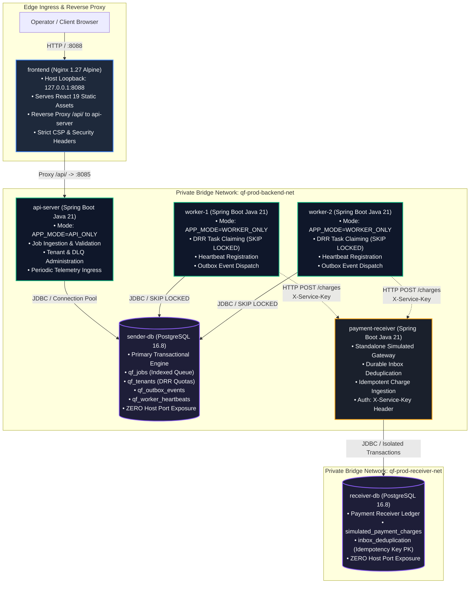

# QueueForge V2 — System Architecture & Distributed Topology

**Document Identifier:** `QF-ARCH-V2-TOPOLOGY`  
**Classification:** Engineering Architecture Reference  
**Verified Git Baseline:** `95884060c7ce2493369f1cd6b47b00b7afacaae0`  
**Deployment Status:** Pre-provisioned Local / Containerized (VPS Hosting Postponed)  

---

## 1. Architectural Philosophy & Problem Statement

Modern microservice and SaaS platforms frequently require asynchronous background job execution (invoice generation, webhook delivery, batch analytics, report generation). Standard industry architectures typically address this with external message brokers (such as RabbitMQ, Kafka, or Celery) paired with in-memory workers.

However, external brokers introduce significant operational complexity and the **Dual-Write Hazard**:
- If an application commits an entity mutation to PostgreSQL and crashes before successfully publishing an event to the message broker, the background task is permanently lost.
- Achieving consistency across distinct storage engines requires complex Distributed 2-Phase Commit (2PC) protocols or heavy CDC (Change Data Capture) infrastructure (e.g., Debezium).
- Naive relational database queues (`SELECT ... FOR UPDATE`) suffer from catastrophic row lock contention, table lock escalation, and head-of-line serialization when concurrent worker threads query the head of the queue.

### The QueueForge Solution
QueueForge V2 transforms **PostgreSQL 16** into an ACID-compliant, contention-free, multi-tenant distributed task queue and event outbox. It eliminates external brokers while guaranteeing transactional atomicity, contention-free concurrent worker claiming via `SELECT FOR UPDATE SKIP LOCKED`, cryptographic lease fencing, and starvation-resistant Deficit Round Robin (DRR) fair scheduling.

---

## 2. Seven-Service Production Topology

QueueForge V2 is organized into a decoupled, seven-container micro-cluster:

---

## 3. Container Boundaries & Responsibilities

| Container Name | Base Image | Role / Responsibility | Resource Limits | Network Isolation |
| :--- | :--- | :--- | :---: | :--- |
| **`frontend`** | `nginx:1.27-alpine` | Edge reverse proxy, static asset delivery for React 19 SPA, TLS termination gateway upstream. | 128 MB RAM, 0.25 CPU | Binds host `127.0.0.1:8088`. Member of `qf-prod-frontend-net` and `qf-prod-backend-net`. |
| **`api-server`** | `eclipse-temurin:21-jre-alpine` | Web API gateway running in `API_ONLY` mode. Handles job submissions, auth sessions, tenant provisioning, DLQ inspection, and metric counters. | 512 MB RAM, 0.75 CPU | Internal to `qf-prod-backend-net`. No exposed host ports. |
| **`worker-1`** | `eclipse-temurin:21-jre-alpine` | Independent background worker running in `WORKER_ONLY` mode. Claims and processes jobs via DRR scheduling; emits heartbeats. | 384 MB RAM, 0.75 CPU | Internal to `qf-prod-backend-net`. No exposed host ports. |
| **`worker-2`** | `eclipse-temurin:21-jre-alpine` | Concurrent worker replica running in `WORKER_ONLY` mode. Provides horizontal scale, failover redundancy, and validates multi-worker fencing. | 384 MB RAM, 0.75 CPU | Internal to `qf-prod-backend-net`. No exposed host ports. |
| **`payment-receiver`**| `eclipse-temurin:21-jre-alpine` | Standalone payment gateway microservice. Ingests charge events, enforces durable deduplication, and handles idempotent replays. | 384 MB RAM, 0.50 CPU | Dual-homed: bridges `qf-prod-backend-net` (HTTP ingress) and `qf-prod-receiver-net` (database). |
| **`sender-db`** | `postgres:16.8-alpine` | Primary transactional database. Stores jobs, logs, outbox events, tenants, and heartbeats. | 384 MB RAM, 1.00 CPU | Internal to `qf-prod-backend-net`. Port 5432 is strictly unexposed to host. |
| **`receiver-db`** | `postgres:16.8-alpine` | Dedicated database for payment receiver ledger and idempotency deduplication records. | 256 MB RAM, 0.50 CPU | Internal to `qf-prod-receiver-net`. Completely isolated from backend workers. |

*Total Aggregate Cluster Memory Limit:* **~2.43 GB**, leaving ample headroom on a modest 4 GB RAM VPS or local development laptop.

---

## 4. Telemetry, Monitoring & Client Synchronization

QueueForge V2 implements a reliable, non-blocking telemetry architecture:
1. **Periodic REST Polling via TanStack Query:**
   - The frontend operational console uses `@tanstack/react-query` with a periodic 3-second interval (`refetchInterval: 3000`) querying `/api/v1/dashboard/stats`, `/api/v1/jobs`, and `/api/v1/system/health`.
   - When inspecting active jobs in detail, polling dynamically accelerates to 2 seconds (`refetchInterval: 2000`).
   - If network connectivity is interrupted, queries fail gracefully, displaying offline badges without crashing the client interface.
2. **Micrometer & Prometheus Metrics Ingress:**
   - The backend exposes standard Prometheus telemetry at `/actuator/prometheus` and Kubernetes-compatible health probes at `/actuator/health/liveness` and `/actuator/health/readiness`.
   - Metrics include job claim rates, queue latency timers, execution durations, tenant deficit gauges, and active worker counters.

---

## 5. Security & Isolation Invariants

1. **Zero Public Database Access:** PostgreSQL port 5432 is completely omitted from the Compose `ports` configuration; database instances are accessible only via Docker container DNS names inside bridge networks.
2. **Least Privilege Container Runtimes:** The backend container runs under unprivileged non-root user `queueforge:queueforge` (`UID 10001`).
3. **Constant-Time Cryptographic Verification:** All credential checks (`X-Admin-Key`, `X-Service-Key`, CSRF tokens) utilize `java.security.MessageDigest.isEqual` to prevent side-channel timing attacks.
4. **Hashed Tenant Credentials:** Plaintext API keys are never stored in the database. Flyway V7 migrated all keys to SHA-256 verifiers (`api_key_hash`) with safe 8-character display prefixes (`api_key_prefix`).
