# QueueForge V2 — Transactional Outbox & Idempotent Consumer Flow

**Document Identifier:** `QF-ARCH-V2-OUTBOX`  
**Classification:** Cross-Service Consistency Specification  
**Verified Source References:** [OrderService.java](..\..\backend\src\main\java\com\queueforge\outbox\service\OrderService.java), [OutboxDispatcherService.java](..\..\backend\src\main\java\com\queueforge\outbox\service\OutboxDispatcherService.java), [HttpPaymentClient.java](..\..\backend\src\main\java\com\queueforge\outbox\client\HttpPaymentClient.java), [PaymentReceiverService.java](..\..\simulated-payment-receiver\src\main\java\com\queueforge\receiver\service\PaymentReceiverService.java)  

---

## 1. The Dual-Write Problem in Microservices

When a business service must record an entity in its local database and communicate that event to an external service (e.g., payment gateway, accounting system, notification provider), performing these operations sequentially creates a fatal consistency dilemma:

```
[Business Operation] ──(1) Write to DB──> [Local Database: COMMITTED]
         │
         ├──(2) Network Call to Remote Service──> [NETWORK FAILURE / CRASH]
         ▼
[EVENT PERMANENTLY LOST: State is inconsistent]
```

If the database commits but the network call fails, the event is permanently lost. If the network call executes first but the database rollback occurs, external side-effects (e.g., credit card charges) take place for non-existent orders.

---

## 2. The Transactional Outbox Solution

QueueForge V2 resolves this using the **Transactional Outbox Pattern** paired with a **Durable Idempotent Receiver**:

```mermaid
sequenceDiagram
    autonumber
    actor Client as Ingress Client / User
    participant OrderSvc as OrderService
    participant DB as Sender PostgreSQL (qf_orders, qf_outbox_events)
    participant Dispatcher as OutboxDispatcherScheduler
    participant Receiver as PaymentReceiverService
    participant RecDB as Receiver PostgreSQL (inbox_deduplication)

    rect rgb(20, 30, 45)
        Note over OrderSvc,DB: Step 1: Atomic Dual-Write in Single ACID Transaction
        Client->>OrderSvc: POST /api/v1/orders (orderNumber, amount, currency)
        OrderSvc->>DB: INSERT INTO qf_orders (status='CREATED')
        OrderSvc->>DB: INSERT INTO qf_outbox_events (idempotency_key, fingerprint, status='PENDING')
        Note over DB: Both rows committed atomically. Zero dual-write hazard.
        DB-->>OrderSvc: Transaction Committed
        OrderSvc-->>Client: 201 Created (Order Response)
    end

    rect rgb(30, 25, 45)
        Note over Dispatcher,RecDB: Step 2: At-Least-Once HTTP Dispatch & Durable Deduplication
        Dispatcher->>DB: SELECT * FROM qf_outbox_events WHERE status='PENDING' FOR UPDATE SKIP LOCKED
        DB-->>Dispatcher: OutboxEvent (idempotency_key, payload)
        Dispatcher->>Receiver: HTTP POST /api/v1/payments/charges<br/>Header: X-Service-Key, Idempotency-Key
        
        Receiver->>RecDB: SELECT * FROM inbox_deduplication WHERE idempotency_key = ?
        alt Fresh Key (First Time Seen)
            Receiver->>RecDB: INSERT INTO simulated_payment_charges (status='SUCCEEDED')
            Receiver->>RecDB: INSERT INTO inbox_deduplication (idempotency_key, fingerprint, response_payload)
            Receiver-->>Dispatcher: 201 Created (fresh charge response)
        else Duplicate Key (Cached Outcome)
            Receiver->>Receiver: Compare inbound fingerprint with stored fingerprint
            Note over Receiver: Fingerprint Matches -> Safe Replay
            Receiver-->>Dispatcher: 200 OK (cached response, idempotentReplay=true)
        end

        Dispatcher->>DB: UPDATE qf_outbox_events SET status='DELIVERED'<br/>UPDATE qf_orders SET status='PAID'
    end
```



---

## 3. Sender Implementation Details

### 3.1 Atomic Dual-Write
Implemented in [OrderService.java](..\..\backend\src\main\java\com\queueforge\outbox\service\OrderService.java#L49-L70):
```java
@Transactional
public OrderResponse createOrder(CreateOrderRequest request) {
    // 1. Persist Order entity
    OrderEntity order = new OrderEntity(
            request.orderNumber().trim(),
            request.customerId().trim(),
            request.amountCents(),
            request.currency().trim().toUpperCase()
    );
    OrderEntity savedOrder = orderRepository.save(order);

    // 2. Build Outbox Event with durable idempotency key and SHA-256 fingerprint
    String idempotencyKey = "order-payment-" + savedOrder.getId();
    String fingerprint = computeFingerprint(savedOrder.getId(), savedOrder.getAmountCents(), savedOrder.getCurrency());

    OutboxEventEntity outboxEvent = new OutboxEventEntity(
            "ORDER",
            savedOrder.getId().toString(),
            "ORDER_PAYMENT_REQUESTED",
            idempotencyKey,
            fingerprint,
            payloadNode
    );
    outboxEventRepository.save(outboxEvent);

    return toResponse(savedOrder);
}
```

### 3.2 Dispatching Engine
- [OutboxDispatcherScheduler.java](..\..\backend\src\main\java\com\queueforge\outbox\scheduler\OutboxDispatcherScheduler.java) runs periodically (default every 500ms).
- Queries `qf_outbox_events` with `SELECT ... WHERE status = 'PENDING' AND scheduled_at <= CURRENT_TIMESTAMP ORDER BY scheduled_at ASC LIMIT 50 FOR UPDATE SKIP LOCKED`.
- [HttpPaymentClient.java](..\..\backend\src\main\java\com\queueforge\outbox\client\HttpPaymentClient.java) dispatches the HTTP request with:
  - Header `Idempotency-Key: order-payment-<orderId>`
  - Header `X-Service-Key: <internal_key>` (constant-time verification)
  - Connection timeout: 2000ms | Read timeout: 3000ms

---

## 4. Receiver Durable Idempotency & Conflict Detection

Implemented in [PaymentReceiverService.java](..\..\simulated-payment-receiver\src\main\java\com\queueforge\receiver\service\PaymentReceiverService.java#L54-L170):

### 4.1 Schema Guarantees
In `receiver-db`, the `inbox_deduplication` table defines `idempotency_key` as its **PRIMARY KEY**:
```sql
CREATE TABLE inbox_deduplication (
    idempotency_key VARCHAR(128) PRIMARY KEY,
    request_fingerprint VARCHAR(64) NOT NULL,
    charge_id UUID REFERENCES simulated_payment_charges(id) ON DELETE CASCADE,
    response_payload JSONB NOT NULL,
    status VARCHAR(32) NOT NULL,
    created_at TIMESTAMPTZ NOT NULL DEFAULT NOW(),
    updated_at TIMESTAMPTZ NOT NULL DEFAULT NOW()
);
```

### 4.2 Idempotency Conflict Detection
If a caller submits an existing `idempotency_key` but alters the payload (e.g., attempts to charge \$500 instead of \$50):
```java
if (!existing.getRequestFingerprint().equals(expectedFingerprint)) {
    log.warn("[Receiver] Idempotency conflict for key '{}'", idempotencyKey);
    throw new IdempotencyConflictException(idempotencyKey); // Returns HTTP 409 Conflict
}
```
The receiver immediately throws `IdempotencyConflictException`, preventing parameter tampering under an existing key.

### 4.3 Concurrent Duplicate Race Handling
If network latency or client retries cause two identical HTTP requests to arrive at the payment receiver concurrently:
1. Both requests see that the inbox record does not yet exist.
2. The first request successfully inserts into `simulated_payment_charges` and `inbox_deduplication`.
3. The second request attempts to insert into `inbox_deduplication`, violating the primary key constraint (`DataIntegrityViolationException`).
4. The receiver catches `DataIntegrityViolationException`, polls for the winner's committed transaction (up to 5 retries with backoff), and returns the winner's response with `idempotentReplay = true` and HTTP 200 OK. Zero duplicate charges are ever committed.

---

## 5. Lost-Acknowledgment Recovery Scenario

```
Sender                              Payment Receiver
  │                                        │
  │──── (1) POST /charges (Key: K1) ───────>│ (Commits Charge & Deduplication in DB)
  │                                        │
  │   x── (2) HTTP Connection Severed ─────│ (Response Lost in Transit)
  │
(Timeout Exception Caught)
(Event remains PENDING in outbox with backoff)
  │
  │──── (3) Retried POST (Key: K1) ───────>│ (Finds K1 in inbox_deduplication)
  │                                        │ (Returns Cached Response: HTTP 200 OK)
  │<─── (4) 200 OK (idempotentReplay=true) ─│
  │
(Outbox Marked DELIVERED, Order Marked PAID)
```
Even if the physical network connection drops immediately after the receiver commits, subsequent retries resolve idempotently with zero data loss and zero duplicate financial operations.
