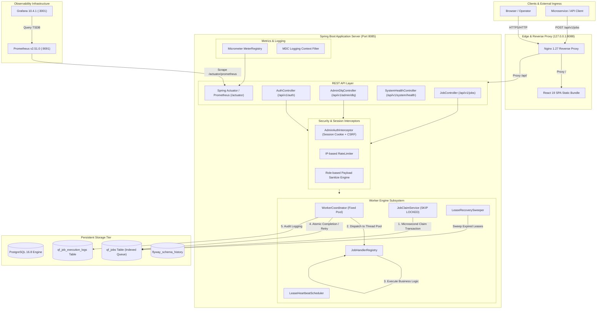
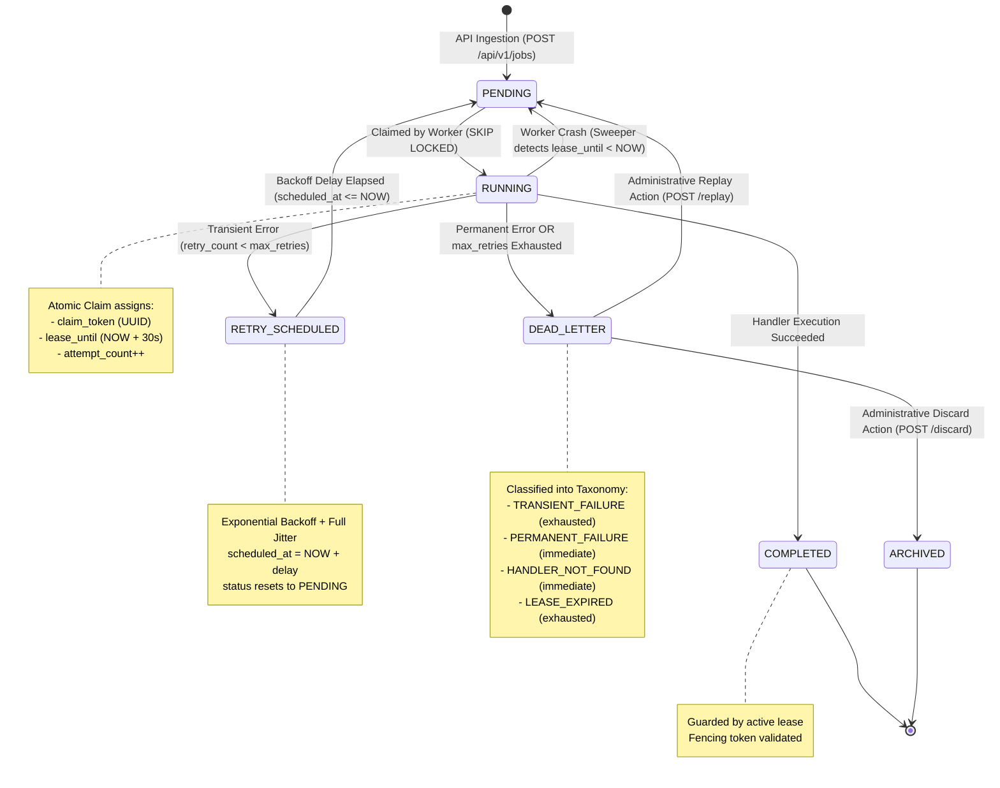
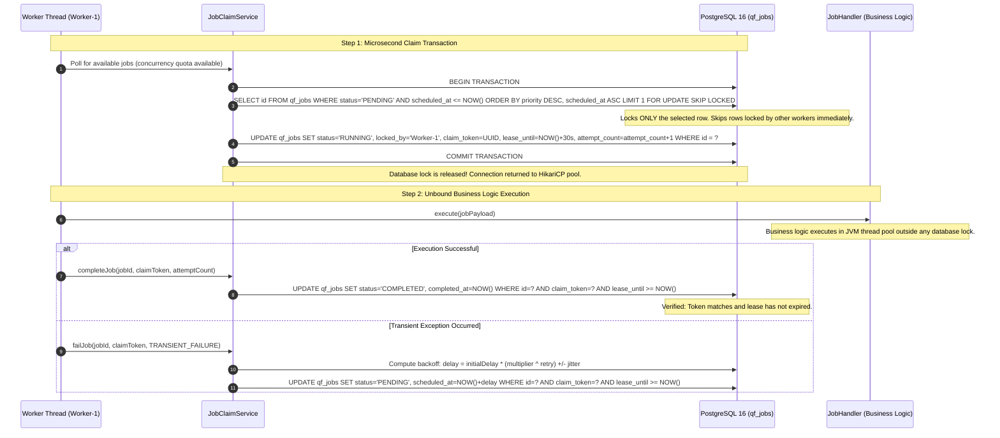
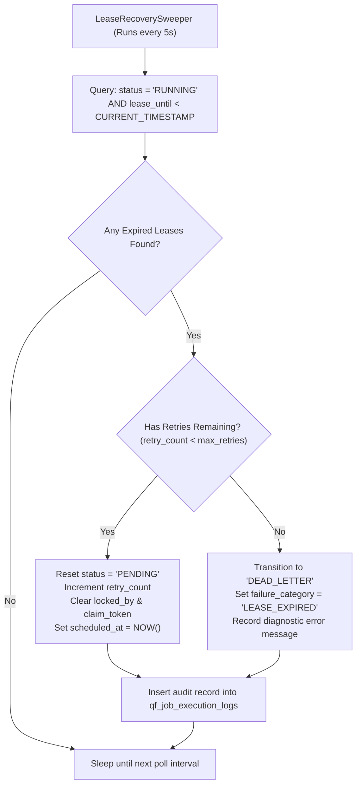

# QueueForge Architecture & Technical Specification

## 1. Executive Summary & Design Rationale

QueueForge is an asynchronous, guaranteed-delivery background task execution engine built with Java 21, Spring Boot 3.3.5, PostgreSQL 16, and React 19. It solves the classic distributed systems challenge of reliable background processing without the operational overhead and operational complexity of external message brokers (such as RabbitMQ or Kafka) for workloads where transactional durability, auditability, and SQL-level inspection are paramount.

---

## 2. System Architecture

---

## 3. Job Processing Lifecycle

---

## 4. Concurrent Worker Claiming & Lease Fencing

To ensure high concurrency without lock contention or thread blocking, QueueForge decouples job claiming from job execution.

---

## 5. Active Lease Guard & Worker Crash Recovery

Distributed systems often suffer from "zombie workers": a worker experiences a long JVM stop-the-world garbage collection pause or network partition, loses its lease to another worker, and later wakes up attempting to write its outdated result.

QueueForge eliminates zombie writes using **Dual Fencing**:
1. **Cryptographic Claim Tokens:** Every claim assigns a new random UUID `claim_token`.
2. **Temporal Lease Guard:** Updates must satisfy `WHERE id = ? AND claim_token = ? AND (lease_until IS NULL OR lease_until >= CURRENT_TIMESTAMP)`.

---

## 6. Technical Decisions & Tradeoffs

| Decision | Rationale | Trade-Off Considered |
| :--- | :--- | :--- |
| **PostgreSQL vs. RabbitMQ / Kafka** | Leverages ACID transactions, transactional outbox pattern readiness, and SQL-level inspection. Zero secondary broker operational complexity. | Throughput ceiling is bounded by PostgreSQL write IOPS (~500–2,000 jobs/sec on typical hardware) vs. Kafka's 100k+/sec log append. Ideal for transactional, high-value jobs. |
| **`SELECT FOR UPDATE SKIP LOCKED`** | Eliminates thread blocking, table locking, and deadlocks across concurrent workers. | Requires indexed queries (`status`, `scheduled_at`, `priority`) to maintain efficient index scans as table size grows. |
| **Decoupled Claim & Execution** | DB locks are held for milliseconds during status transition, then freed. Long-running handler tasks never exhaust database connection pools. | Requires heartbeat mechanism and lease timeout to reclaim orphaned jobs if workers crash mid-execution. |
| **In-Memory Rate Limiting & Session Store** | Ultra-fast authentication verification with zero database query overhead during API routing. | Sessions do not persist across backend container restarts and cannot be shared across multiple backend replicas without an external cache like Redis. |
| **Full Jitter Exponential Backoff** | Prevents synchronized retry spikes ("thundering herd") against recovering downstream microservices. | Introduces minor non-determinism in exact retry arrival times within the bounded $\pm 20\%$ jitter window. |
