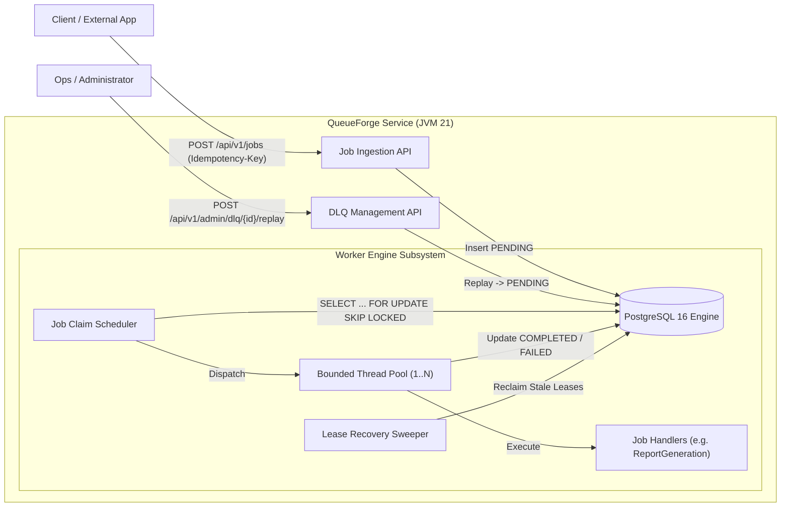
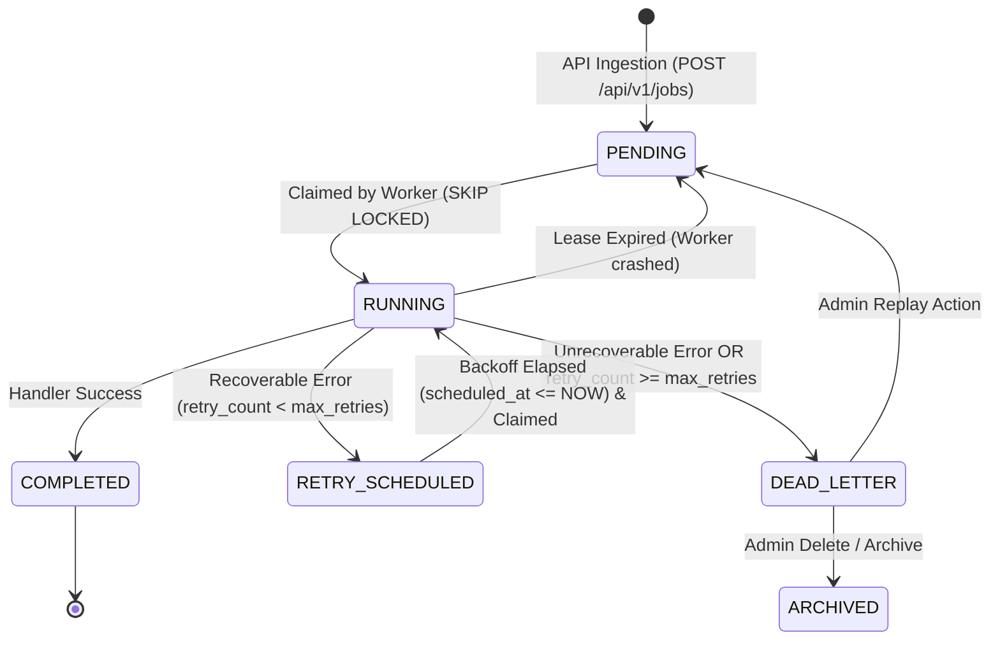

# QueueForge Architecture & Design Specification

## 1. System Overview

QueueForge is designed as a modular monolith providing asynchronous, guaranteed-delivery background job processing using PostgreSQL as a durable queue.



---

## 2. Core Architectural Guarantees

### At-Least-Once Delivery Semantics
Jobs are guaranteed to be executed at least once. If a worker thread or process crashes after the handler executes but before the database status is updated to `COMPLETED`, the job lease will expire and a surviving worker will re-execute the job. Therefore:
- All job handlers must be designed to be **idempotent**.
- Handlers should store checkpoint tokens or use database unique constraints where external side-effects occur.

### Contention-Free Job Claiming (`SKIP LOCKED`)
Traditional relational queue implementations often suffer from row-level lock contention and serialization deadlocks when multiple workers query the head of the queue concurrently.

QueueForge uses PostgreSQL's row-level lock skipping:
```sql
UPDATE qf_jobs
SET 
    status = 'RUNNING',
    locked_by = :workerId,
    lease_until = CURRENT_TIMESTAMP + (:leaseSeconds * INTERVAL '1 second'),
    updated_at = CURRENT_TIMESTAMP
WHERE id IN (
    SELECT id
    FROM qf_jobs
    WHERE status = 'PENDING'
      AND scheduled_at <= CURRENT_TIMESTAMP
    ORDER BY priority DESC, scheduled_at ASC
    LIMIT :batchSize
    FOR UPDATE SKIP LOCKED
)
RETURNING *;
```
When multiple workers execute this transaction simultaneously:
- Worker 1 claims rows 1 through 10.
- Worker 2 skips rows 1 through 10 immediately without blocking, locking rows 11 through 20.
- Database transactions remain instantaneous (`< 5ms`), freeing connections back to the HikariCP pool.

### Crash & Lease Recovery
- Every claimed job receives a `lease_until` timestamp (`CURRENT_TIMESTAMP + leaseDuration`).
- Long-running jobs periodically issue a heartbeat update to extend `lease_until`.
- A background scheduler (`LeaseRecoveryManager`) periodically sweeps for orphaned rows:
```sql
UPDATE qf_jobs
SET 
    status = 'PENDING',
    locked_by = NULL,
    lease_until = NULL,
    retry_count = retry_count + 1,
    last_error_message = 'Worker lease timed out; reclaimed by LeaseSweeper',
    updated_at = CURRENT_TIMESTAMP
WHERE status = 'RUNNING'
  AND lease_until < CURRENT_TIMESTAMP;
```

---

## 3. Job State Lifecycle



---

## 4. Exponential Backoff Formula
To prevent thundering-herd problems against failed downstream systems:
$$\text{Delay}(n) = \min\left(M,\ B \cdot 2^n\right) \times \left(1 + \text{rand}(-J, J)\right)$$
Where:
- $B$ = Base delay (e.g., 5 seconds)
- $n$ = `retry_count`
- $M$ = Maximum backoff ceiling (e.g., 3600 seconds)
- $J$ = Jitter factor (e.g., 20%)

---

## 5. Storage and Isolation Architecture

To comply with system drive isolation constraints:
- **Build & Dependencies:** Maven local repository is located at `D:\Development\maven-repository`.
- **Runtime Temp:** Temp files are isolated to `D:\Projects\QueueForge\temp`.
- **Database Engine:** PostgreSQL runs in a dedicated Docker container on port `5435`.
- **Database Data:** Persistent data is stored in `D:\Projects\QueueForge\data\postgres` through a host bind-mount.
- **Docker WSL2 VHDX:** Container layers and image caches reside in `D:\Development\docker-data\disk\DockerDesktopWSL\disk\docker_data.vhdx`.
