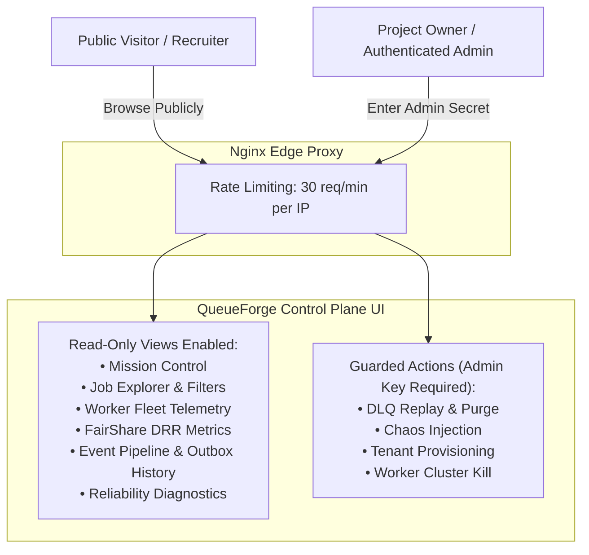

# QueueForge — Public Demonstration Security Model & Threat Assessment

**Author**: Software Security Engineer & Staff DevOps Engineer  
**Date**: November 2026  
**Status**: APPROVED SPECIFICATION  

---

## 1. Threat Model for Internet-Facing Portfolio Demonstration

When deploying QueueForge as a public demonstration project for recruiters and engineering hiring managers, the system must balance **unimpeded observability** with **absolute operational safety**.

### Identified Threat Vectors
1. **Administrative Abuse**: Malicious or unauthorized visitors executing destructive DLQ operations (`DELETE /api/v1/dlq/purge`), tampering with tenant configurations, or modifying worker concurrency.
2. **Chaos Injection in Production**: Visitors triggering simulated crashes or poison pills via ChaosLab endpoints (`POST /api/v1/chaos/inject`), causing denial of service.
3. **Database Port Probing**: Direct external connection attempts against PostgreSQL port 5432.
4. **Denial of Service (DoS) via Job Flooding**: Unauthenticated or automated bots flooding the queue with hundreds of thousands of jobs to exhaust host memory or NVMe disk space.
5. **Credential Leakage**: Default development passwords or API keys (`qf_admin_dev_secret_2026`) being used in a live public deployment.

---

## 2. Audit of Existing Security Controls in Source Code

The QueueForge V2 codebase already incorporates enterprise-grade security primitives:

| Security Domain | Implementation | Code Location / Migration | Enforcement Mechanism |
|---|---|---|---|
| **Admin Authentication** | Pre-Shared Admin Key / Constant-Time Comparison | `AdminAuthInterceptor.java` | Protected admin endpoints require valid `QF_SESSION` cookie or `X-Admin-Key` header with `MessageDigest.isEqual`. |
| **Session Security** | HttpOnly, SameSite=Lax, Secure Cookies | `AuthController.java` | Prevents JavaScript XSS cookie extraction; Secure flag enforced behind reverse proxy via `server.forward-headers-strategy: framework`. |
| **CSRF Defense** | Cryptographic Token Header | `AdminAuthInterceptor.java` | State-mutating methods (`POST`, `PUT`, `DELETE`) require header `X-CSRF-Token` matching session token. |
| **Tenant Verification** | SHA-256 Key Hashing | `V7__secure_tenant_credentials.sql` | Tenant API keys are never stored in plaintext; authenticated via constant-time hash comparison (`ApiKeyHasher.hash`). |
| **Cross-Service Outbox Auth** | Pre-Shared Service Key Header | `PaymentReceiverController.java` | Outbox payment charges require header `X-Service-Key` matching `RECEIVER_SERVICE_KEY` with constant-time comparison. |
| **CORS Policy** | Strict Externalized Allowed Origins | `WebMvcConfig.java` | Configured via `QUEUEFORGE_CORS_ALLOWED_ORIGINS`; rejects unauthorized cross-origin requests. |
| **Container Networking** | Private Docker Bridge Subnets | `docker-compose.v2.yml` | DB ports 5432 and backend ports 8085-8087 are completely isolated from host interfaces. |

---

## 3. The "Portfolio Mode" Architecture

To allow public portfolio visitors (recruiters, hiring managers) to experience QueueForge without risking service integrity, QueueForge implements a dual-role access model:



### 3.1 Public Visitor Permissions (Unauthenticated)
- **View Dashboard Metrics**: Ingest rate, throughput, failure rate, active worker count.
- **Search & Inspect Jobs**: View job status (`PENDING`, `RUNNING`, `COMPLETED`, `DEAD_LETTER`), execution history, and worker attribution.
- **Inspect Worker Fleet**: View real-time heartbeats, node instance IDs (`worker-v2-node-1`), CPU and heap metrics from `qf_worker_heartbeats`.
- **Examine FairShare Analytics**: Inspect tenant quotas, deficit round-robin weights, and concurrency utilization.
- **Audit Event Pipeline**: Inspect outbox transactional records, delivery status (`PAID`), and idempotency keys.

### 3.2 Guarded Administrative Actions (Owner Session Required)
- **DLQ Purge**: Emptying dead-letter records.
- **DLQ Replay**: Re-enqueueing failed poison-pill jobs.
- **Tenant Provisioning**: Creating new tenants with high concurrency weights.
- **Chaos Injection**: Triggering worker fault simulations.

When an unauthenticated visitor attempts any guarded action, the Obsidian Pulse UI surfaces the **Admin Unlock Modal**, prompting for the private administrator key. Without this key, write operations return `HTTP 401 Unauthorized`.

---

## 4. Required Pre-Deployment Configuration Hardening

Before deploying to an internet-facing host, the following operational requirements must be enforced:

### 4.1 Strict Removal of Default Development Secrets
The application must fail to start if default development secrets are detected:
- **`ADMIN_API_KEY`**: Must be set to a high-entropy string (`openssl rand -hex 32`). The default `qf_admin_dev_secret_2026` is rejected by `application-prod.yml` (`enforce-strong-admin-key: true`).
- **`DB_PASSWORD`**: Must be set via environment variable (`openssl rand -base64 24`).
- **`RECEIVER_SERVICE_KEY`**: Must be set to an independent 256-bit secret.

### 4.2 Disable Production Chaos Injection
In `application-prod.yml`:
```yaml
queueforge:
  worker:
    chaos-payloads-enabled: false
```
This ensures that even if an attacker attempts to inject a poison payload containing `"injectFault": "JVM_CRASH"`, the worker treats it as a standard business job and refuses to execute destructive process exits.

### 4.3 Nginx Edge Rate Limiting
To prevent automated crawling or denial of service, Nginx configuration must define request rate limits:
```nginx
limit_req_zone $binary_remote_addr zone=api_limit:10m rate=30r/m;
limit_req_zone $binary_remote_addr zone=static_limit:10m rate=120r/m;

location /api/ {
    limit_req zone=api_limit burst=20 nodelay;
    proxy_pass http://backend:8085;
}
```

### 4.4 HTTPS & Cookie Security
When serving behind TLS (HTTPS), Nginx forwards `$scheme = https` via `X-Forwarded-Proto`, and the backend sets the `Secure` flag on `admin_session` cookies:
```java
ResponseCookie cookie = ResponseCookie.from("admin_session", token)
    .httpOnly(true)
    .secure(isHttps)
    .sameSite("Strict")
    .path("/")
    .maxAge(Duration.ofHours(8))
    .build();
```
