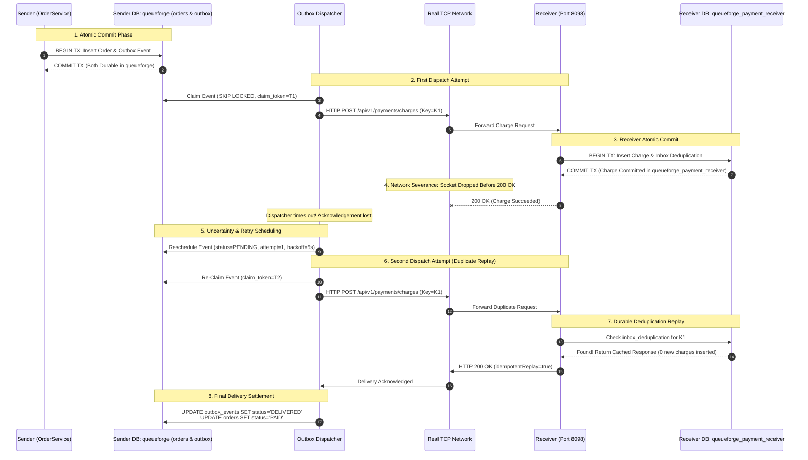

# QueueForge V2: Real Distributed Outbox Consistency & Idempotent Business Processing

This document provides the architectural specification, formal consistency boundaries, failure recovery mechanics, and empirical verification results for QueueForge's **Transactional Outbox** and **Independent Idempotent Consumer Consistency Boundary**.

---

## 1. The Dual-Write Problem

In distributed architectures, business operations frequently require mutating local database state (e.g., creating an Order) and informing downstream systems (e.g., initiating a Payment or dispatching a message).

A naive implementation attempts to perform both synchronously within one application method:

```java
@Transactional
public void processOrder(OrderRequest request) {
    Order order = orderRepository.save(new Order(request)); // (1) Database Mutation
    paymentGatewayClient.charge(order);                     // (2) External Network Call
}
```

This architecture suffers from the fundamental **Dual-Write Vulnerability**:
1. **Network failure after database commit**: If the payment gateway succeeds but the network packet or database commit fails, the customer is charged without an order existing in the database.
2. **Crash between database write and network dispatch**: If the application crashes immediately after saving the order, the payment is never triggered, stranding the order indefinitely.
3. **Database transactions cannot span external network calls**: An ACID transaction in PostgreSQL can lock, validate, and rollback relational tables. It *cannot* roll back an HTTP POST request executed against an external payment processor or an uncommitted broker socket.

---

## 2. Distributed Architecture: Two-Process & Two-Database Isolation

In QueueForge V2 Phase 3B, the architecture was evolved from an in-process simulation into a **genuine two-process, two-database distributed deployment**.

```
+----------------------------------------------------------------------------------------------------+
|                                    SENDER PROCESS (JVM 1 - Port 8085)                              |
|                                                                                                    |
|  [Client] ---> [OrderController] ---> [OrderService]                                               |
|                                            |                                                       |
|                                            +--- BEGIN TX (queueforge DB) -----------------------+  |
|                                            |  1. INSERT INTO orders (status = 'CREATED')        |  |
|                                            |  2. INSERT INTO outbox_events (status = 'PENDING') |  |
|                                            +--- COMMIT TX --------------------------------------+  |
+----------------------------------------------------------------------------------------------------+
                                             |
                                             | (PostgreSQL Catalog: 'queueforge')
                                             v
+----------------------------------------------------------------------------------------------------+
|                       OUTBOX DISPATCHER (Background Thread / Scheduler)                            |
|                                                                                                    |
|  - SELECT ... FROM outbox_events WHERE status = 'PENDING' FOR UPDATE SKIP LOCKED                   |
|  - Lease Fencing: claim_token (UUID), claim_expires_at (TTL)                                       |
|  - HttpPaymentClient: Real Java 21 HttpClient with bounded connect (2s) & read (5s) timeouts       |
+----------------------------------------------------------------------------------------------------+
                                             |
                                  REAL HTTP / TCP SOCKET
                          POST http://127.0.0.1:8098/api/v1/payments/charges
                         (Unreliable Network: Dropped packets, Socket Timeouts)
                                             |
                                             v
+----------------------------------------------------------------------------------------------------+
|                             RECEIVER PROCESS (JVM 2 - Port 8098)                                   |
|                                                                                                    |
|  [PaymentReceiverController] ---> [PaymentReceiverService]                                         |
|                                         |                                                          |
|                                         +--- BEGIN TX (queueforge_payment_receiver DB) ----------+ |
|                                         |  1. SELECT FROM inbox_deduplication                     | |
|                                         |     - Key Found + Same Fingerprint: Return Cached 200  | |
|                                         |     - Key Found + Different Fingerprint: 409 Conflict  | |
|                                         |     - Key Not Found:                                   | |
|                                         |         INSERT INTO simulated_payment_charges          | |
|                                         |         INSERT INTO inbox_deduplication (Atomic Unique)| |
|                                         +--- COMMIT TX ------------------------------------------+ |
+----------------------------------------------------------------------------------------------------+
```

### Complete Service & Database Boundaries
| Architectural Boundary | Sender Service (`queueforge-backend`) | Receiver Service (`simulated-payment-receiver`) |
| :--- | :--- | :--- |
| **Runtime Environment** | Java 21 / Spring Boot 3.3.5 (Port 8085) | Java 21 / Spring Boot 3.3.5 (Port 8098) |
| **OS Process** | Independent JVM process | Independent JVM process |
| **Database Catalog** | `queueforge` | `queueforge_payment_receiver` |
| **JDBC Connection Pool** | HikariCP (`QueueForgeHikariPool`) | HikariCP (`ReceiverHikariPool`) |
| **Flyway Migrations** | V1 through V5 (Queue + Outbox schema) | V1 (Receiver charges + inbox schema) |
| **Client Implementation** | `HttpPaymentClient` (`@Primary`) | Exposed via REST controller |
| **Network Protocol** | HTTP/1.1 over TCP sockets | HTTP/1.1 over TCP sockets |

> [!NOTE]
> The original Phase 3 `DirectPaymentClient` and in-process `PaymentReceiverService` are retained strictly as a fast in-memory test fixture (`@ConditionalOnProperty(name = "queueforge.outbox.payment.client-type", havingValue = "DIRECT")`) for unit and integration regression tests. In production and distributed verification, `HttpPaymentClient` connects across process and database boundaries over real HTTP.

---

## 3. Why Consumer Idempotency Is Mandatory

A common fallacy is assuming a Transactional Outbox guarantees "exactly-once delivery". **In distributed systems across unreliable networks, exactly-once network delivery is mathematically impossible (The Two Generals' Problem).**

The Transactional Outbox guarantees **at-least-once delivery**. If the dispatcher crashes while awaiting a response, or if the network connection drops after the receiver commits the charge, the dispatcher cannot know whether the receiver committed or never saw the packet. It must retry.

Without an idempotent consumer, retrying produces **duplicate business side effects** (e.g. charging the customer twice).

### Lost-Acknowledgement Sequence Diagram



---

## 4. Empirical Cross-Process Failure Verification

QueueForge verifies 8 discrete distributed experiments across independent JVM processes and independent PostgreSQL databases via `scripts/verify-distributed-outbox.ps1`:

| Experiment Code | Failure Injection Scenario | Tested Mechanism | Empirical Verification Outcome |
| :--- | :--- | :--- | :--- |
| **Experiment A** | **Sender Crash After Commit Before Delivery** | Killed sender JVM via SIGKILL (`Stop-Process -Force`) immediately after order submission. | **PASSED**: Post-crash query confirmed Order was `CREATED`, Outbox was `PENDING` in `queueforge`, and 0 charges existed in `queueforge_payment_receiver`. On restart, dispatcher recovered and delivered. |
| **Experiment B** | **Dispatcher Crash After Claim (Lease Expiration)** | Claimed event with 2s lease, then killed dispatcher JVM mid-flight. | **PASSED**: Event remained `DISPATCHING`; after 3s TTL, second dispatcher reclaimed via `SKIP LOCKED` and delivered successfully. |
| **Experiment C** | **Lost HTTP Acknowledgement (Socket Severance)** | Receiver fault hook committed charge to `queueforge_payment_receiver`, then severed TCP socket before returning HTTP ACK. | **PASSED**: Audit in uncertain state proved charge and inbox row existed in receiver DB, while sender DB remained `PENDING`. |
| **Experiment D** | **Duplicate Retry & Idempotent Replay** | Dispatcher retried duplicate event against receiver after connection drop. | **PASSED**: Receiver detected duplicate key, returned cached charge (`idempotentReplay=true`), sender marked `DELIVERED` & `PAID`. Receiver DB had **EXACTLY 1 charge** (zero double charging). |
| **Experiment E** | **Two Concurrent Independent Dispatcher Processes** | Two independent JVMs (ports 8085 and 8086) simultaneously dispatched 10 pending events. | **PASSED**: PostgreSQL `SKIP LOCKED` partitioned events with zero duplicates and zero deadlock (10 total delivered, exactly 10 charges in receiver DB). |
| **Experiment F** | **Receiver Process Outage & Eventual Delivery** | Terminated receiver JVM via SIGKILL during dispatch. | **PASSED**: Dispatcher caught `ConnectException`, scheduled exponential backoff; restarted receiver JVM, and subsequent retry succeeded. |
| **Experiment G** | **Conflicting Payload Fingerprint Rejection** | Reused idempotency key with modified amount / fingerprint. | **PASSED**: Receiver rejected with HTTP 409 Conflict; dispatcher routed event to `DEAD_LETTER`. |
| **Experiment H** | **Fencing Token Monotonicity** | Zombie dispatcher attempted to mark event `DELIVERED` with stale claim token. | **PASSED**: Database rejected update (`UPDATE 0`); winning dispatcher's active token succeeded (`UPDATE 1`). |

---

## 5. Scope & Formal Guarantee Boundaries

To maintain rigorous distributed systems honesty during technical assessments, QueueForge explicitly distinguishes its architectural guarantees:

### What QueueForge Guarantees
1. **Atomic Sender Commit**: An Order and its Outbox Event either both commit or both rollback within `queueforge`.
2. **At-Least-Once Delivery**: The outbox dispatcher guarantees delivery attempts will continue across retries and crashes until acknowledged or routed to `DEAD_LETTER`.
3. **Durable Receiver Deduplication**: The receiver guarantees that under duplicate or concurrent deliveries of the same idempotency key, exactly one payment charge is created in `queueforge_payment_receiver`.
4. **Exactly-Once Business Effect**: Across the entire distributed topology, the business effect (charging the order) occurs exactly once under tested failure conditions.

### What Is NOT Claimed
1. **No "Exactly-Once Network Delivery"**: Network packets can and will duplicate, drop, or delay.
2. **No "Single Distributed 2PC Transaction"**: QueueForge does *not* use Two-Phase Commit or XA transactions across sender and receiver. Sender and receiver maintain completely independent transactional boundaries.
3. **Outbox Alone Does Not Prevent Duplicates**: A transactional outbox without an idempotent consumer is vulnerable to double-charging on lost acknowledgements.

---

## 6. ChaosLab Security Hardening

In Phase 3B, test controls were strictly decoupled from production code:
- **`ReportGenerationJobHandler.java`**: Completely purged of test controls (`signalRunningFile`, `barrierFile`, `delayMs`), returning it to a pure production CPU-bound report generator.
- **`ChaosTestJobHandler.java`**: Dedicated test handler registered only when `queueforge.worker.chaos-payloads-enabled=true`. Implements path traversal sanitization (rejection of `..`, restriction to approved directories) and bounds maximum test wait times to 30 seconds to prevent thread starvation.
- **`WorkerCoordinator.java`**: Heartbeat suspension (`disableHeartbeat`) is strictly gated behind both `properties.isChaosPayloadsEnabled()` and `job.jobType().equalsIgnoreCase("CHAOS_TEST")`.

---

## 7. How to Reproduce and Verify

### 1. Run Backend Unit & Integration Tests (108 Tests)
```powershell
. D:\Projects\QueueForge\env.ps1
cd D:\Projects\QueueForge\backend
mvn test -B
```

### 2. Run Receiver Tests (2 Tests)
```powershell
. D:\Projects\QueueForge\env.ps1
cd D:\Projects\QueueForge\simulated-payment-receiver
mvn test -B
```

### 3. Run Real Cross-Process Distributed Outbox Verification (8 Experiments)
```powershell
powershell.exe -ExecutionPolicy Bypass -File D:\Projects\QueueForge\scripts\verify-distributed-outbox.ps1
```
