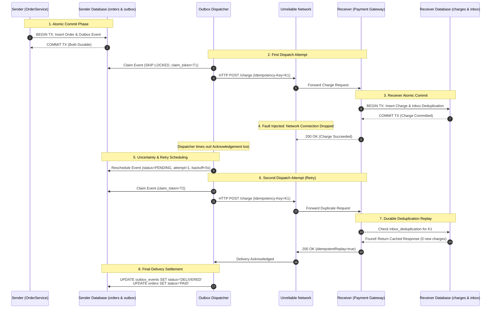

# QueueForge V2: Transactional Outbox & Idempotent Business Processing

This document provides the architectural specification, correctness proofs, failure recovery mechanics, and empirical verification results for QueueForge's **Transactional Outbox** and **Idempotent Consumer Consistency Boundary**.

---

## 1. The Dual-Write Problem

In distributed architectures, business operations frequently require mutating local database state (e.g., creating an Order) and informing downstream systems (e.g., initiating a Payment or dispatching a Kafka message).

A naive implementation attempts to perform both synchronously:

```java
@Transactional
public void processOrder(OrderRequest request) {
    Order order = orderRepository.save(new Order(request)); // (1) Database Mutation
    paymentGatewayClient.charge(order);                     // (2) External Network Call
}
```

This architecture suffers from the fundamental **Dual-Write Vulnerability**:
1. **Network failure after database commit**: If the payment gateway succeeds but the network packet or database commit fails, the customer is charged without an order existing in the database.
2. **Crash between database write and network dispatch**: If the application crashes immediately after saving the order, the payment is never triggered, stranding the order indefinitely.
3. **Database transactions cannot span external network calls**: An ACID transaction in PostgreSQL can lock, validate, and rollback relational tables. It *cannot* roll back an HTTP POST request executed against an external payment processor or an uncommitted broker socket.

---

## 2. Architecture: Transactional Outbox Pattern

QueueForge solves the dual-write problem by replacing the direct network call with an atomic relational insert into an append-only `outbox_events` table within the **exact same database transaction** as the business entity.

```
+-----------------------------------------------------------------------------------------+
|                                    SENDER BOUNDARY                                      |
|                                                                                         |
|  [Client] ---> [OrderService]                                                           |
|                     |                                                                   |
|                     +--- BEGIN TRANSACTION ------------------------------------------+  |
|                     |  1. INSERT INTO orders (id, order_number, status, amount_cents)|  |
|                     |  2. INSERT INTO outbox_events (id, aggregate_id, payload, ...) |  |
|                     +--- COMMIT TRANSACTION -----------------------------------------+  |
+-----------------------------------------------------------------------------------------+
                                      |
                                      | (PostgreSQL durable storage)
                                      v
+-----------------------------------------------------------------------------------------+
|                           OUTBOX DISPATCHER (Background Worker)                         |
|                                                                                         |
|  - SELECT ... FROM outbox_events WHERE status = 'PENDING' FOR UPDATE SKIP LOCKED        |
|  - Lease Fencing: claim_token, claim_expires_at                                         |
|  - Calls External Receiver with Idempotency-Key                                         |
+-----------------------------------------------------------------------------------------+
                                      |
                           (Unreliable Network)
                                      |
                                      v
+-----------------------------------------------------------------------------------------+
|                        RECEIVER BOUNDARY (Payment Provider)                             |
|                                                                                         |
|  [SimulatedPaymentReceiver]                                                             |
|         |                                                                               |
|         +--- BEGIN TRANSACTION (Independent REQUIRES_NEW / Dedicated DB) -------------+ |
|         |  1. Check inbox_deduplication for idempotency_key                             |
|         |     - Found + Matching Fingerprint: Return cached charge (Replay)             |
|         |     - Found + Conflicting Fingerprint: REJECT (409 Conflict)                  |
|         |     - Not Found:                                                              |
|         |         INSERT INTO simulated_payment_charges (...)                           |
|         |         INSERT INTO inbox_deduplication (...)                                 |
|         +--- COMMIT TRANSACTION ------------------------------------------------------+ |
+-----------------------------------------------------------------------------------------+
```

### Publication Flow
1. **Atomic Ingestion**: Client submits order. `OrderService` inserts `orders` row (`status = 'CREATED'`) and `outbox_events` row (`status = 'PENDING'`) inside one ACID transaction. If the transaction rolls back, neither record exists.
2. **Contention-Free Claiming**: `OutboxDispatcherService` queries pending events using `SELECT FOR UPDATE SKIP LOCKED`. This guarantees zero row-level lock contention across multi-threaded or multi-instance dispatchers.
3. **Lease Fencing**: When claimed, the event status is set to `DISPATCHING`, an active `claim_token` is generated, and a `claim_expires_at` timestamp is assigned.
4. **Acknowledged Delivery**: The dispatcher calls the receiver. *Only after receiving a verified 200 OK* does the dispatcher update `outbox_events.status = 'DELIVERED'` and transition `orders.status = 'PAID'`.

---

## 3. Why Consumer Idempotency Is Mandatory

A common fallacy is assuming a Transactional Outbox guarantees "exactly-once delivery". **In distributed systems across unreliable networks, exactly-once network delivery is mathematically impossible (The Two Generals' Problem).**

The Transactional Outbox guarantees **at-least-once delivery**. If the dispatcher crashes while awaiting a response, or if the network connection drops after the receiver commits the charge, the dispatcher must retry.

Without an idempotent consumer, retrying produces **duplicate business side effects** (e.g. charging the customer twice).

### Lost-Acknowledgement Sequence Diagram

The following Mermaid sequence diagram illustrates the critical crash scenario verified in QueueForge Phase 3:



---

## 4. Empirical Failure Experiments & Verification

QueueForge verifies 8 discrete failure experiments across sender and receiver boundaries:

| Scenario Code | Scenario Description | Tested Mechanism | Verification Outcome |
| :--- | :--- | :--- | :--- |
| **Scenario A** | Crash before original database transaction commits | Forced exception before commit | **PASSED**: Neither `orders` nor `outbox_events` persisted in database. |
| **Scenario B** | Crash immediately after order & outbox commit | Application halts post-commit | **PASSED**: Dispatcher background poll discovers pending event and completes delivery. |
| **Scenario C** | Dispatcher crash after event claim | Worker halts while holding claim lease | **PASSED**: Lease expires; second dispatcher re-claims and delivers event. |
| **Scenario D** | **Critical Crash: Receiver commits, but ACK is lost** | Simulated socket drop post-receiver-commit | **PASSED**: Sender retries; receiver deduplicates; **exactly 1 charge** committed. |
| **Scenario E** | Concurrent dispatchers claiming same queue | 4 concurrent threads polling 20 events | **PASSED**: Zero duplicate claims; all 20 events claimed with mutual exclusion via `SKIP LOCKED`. |
| **Scenario F** | Receiver unavailable temporarily | Receiver responds with 503 | **PASSED**: Exponential backoff with jitter scheduled; delivers upon recovery. |
| **Scenario G** | Conflicting payload with same idempotency key | Same key sent with different amount | **PASSED**: Rejected with 409 `IdempotencyConflictException`; routed to `DEAD_LETTER`. |
| **Scenario H** | Repeated transient failures exhausting retries | 5 consecutive connection timeouts | **PASSED**: Retries exhausted (5/5); transitioned to `DEAD_LETTER` with audit reason. |
| **Multi-Thread**| 10 concurrent identical receiver requests | 10 parallel threads with same key | **PASSED**: 1 unique charge inserted, 9 idempotent replays returned. |

---

## 5. Scope & Formal Guarantee Boundaries

To maintain distributed systems precision during technical evaluations, QueueForge explicitly distinguishes its architectural guarantees:

### What QueueForge Guarantees
1. **Atomic Sender Commit**: An Order and its Outbox Event either both commit or both rollback.
2. **At-Least-Once Delivery**: The outbox dispatcher guarantees delivery attempts will continue until acknowledged or terminal retry exhaustion.
3. **Durable Receiver Deduplication**: The receiver guarantees that under concurrent or duplicate deliveries of the same idempotency key, exactly one business side effect (simulated charge) is committed.
4. **Exactly-One Business Effect**: Across the entire system, the business effect (charging the order) occurs exactly once under tested failure conditions.

### What Is NOT Claimed
1. **No "Exactly-Once Network Delivery"**: Network packets can and will duplicate or drop.
2. **No "Single Distributed Transaction"**: QueueForge does *not* use Two-Phase Commit (2PC) or XA transactions across sender and receiver. Sender and receiver maintain completely independent transactional boundaries.
3. **Outbox Alone Does Not Prevent Duplicates**: A transactional outbox without an idempotent consumer is vulnerable to double-charging on lost acknowledgements.

---

## 6. Database Schema Specification

### 1. `orders` Table
```sql
CREATE TABLE orders (
    id UUID PRIMARY KEY,
    order_number VARCHAR(64) NOT NULL UNIQUE,
    customer_id VARCHAR(64) NOT NULL,
    amount_cents BIGINT NOT NULL CHECK (amount_cents > 0),
    currency VARCHAR(3) NOT NULL,
    status VARCHAR(32) NOT NULL,
    created_at TIMESTAMPTZ NOT NULL DEFAULT NOW(),
    updated_at TIMESTAMPTZ NOT NULL DEFAULT NOW()
);
```

### 2. `outbox_events` Table
```sql
CREATE TABLE outbox_events (
    id UUID PRIMARY KEY,
    aggregate_type VARCHAR(64) NOT NULL,
    aggregate_id VARCHAR(64) NOT NULL,
    event_type VARCHAR(64) NOT NULL,
    idempotency_key VARCHAR(128) NOT NULL UNIQUE,
    payload JSONB NOT NULL,
    payload_fingerprint VARCHAR(64) NOT NULL,
    status VARCHAR(32) NOT NULL DEFAULT 'PENDING',
    attempt_count INT NOT NULL DEFAULT 0,
    max_retries INT NOT NULL DEFAULT 5,
    next_retry_at TIMESTAMPTZ NOT NULL DEFAULT NOW(),
    claimed_by VARCHAR(128),
    claim_token UUID,
    claim_expires_at TIMESTAMPTZ,
    last_error TEXT,
    delivered_at TIMESTAMPTZ,
    created_at TIMESTAMPTZ NOT NULL DEFAULT NOW(),
    updated_at TIMESTAMPTZ NOT NULL DEFAULT NOW()
);

CREATE INDEX idx_outbox_claim ON outbox_events(status, next_retry_at)
    WHERE status IN ('PENDING', 'DISPATCHING');
```

### 3. `simulated_payment_charges` Table
```sql
CREATE TABLE simulated_payment_charges (
    id UUID PRIMARY KEY,
    charge_reference VARCHAR(64) NOT NULL UNIQUE,
    order_id UUID NOT NULL,
    customer_id VARCHAR(64) NOT NULL,
    amount_cents BIGINT NOT NULL,
    currency VARCHAR(3) NOT NULL,
    status VARCHAR(32) NOT NULL,
    failure_reason TEXT,
    created_at TIMESTAMPTZ NOT NULL DEFAULT NOW()
);
```

### 4. `inbox_deduplication` Table
```sql
CREATE TABLE inbox_deduplication (
    idempotency_key VARCHAR(128) PRIMARY KEY,
    request_fingerprint VARCHAR(64) NOT NULL,
    charge_id UUID REFERENCES simulated_payment_charges(id) ON DELETE CASCADE,
    response_payload JSONB NOT NULL,
    status VARCHAR(32) NOT NULL,
    created_at TIMESTAMPTZ NOT NULL DEFAULT NOW(),
    updated_at TIMESTAMPTZ NOT NULL DEFAULT NOW()
);
```

---

## 7. Interview-Ready Architecture Talking Points

When presenting this project to Senior Backend and Distributed Systems interviewers:

1. **Why not publish to Kafka directly from the controller?**
   > *"Publishing directly introduces the dual-write problem. If the HTTP call to Kafka fails after the database commits, or the application crashes mid-flight, the event is permanently lost. Writing to an Outbox table in the same ACID transaction guarantees zero event loss."*

2. **Why PostgreSQL `SKIP LOCKED` instead of an external message broker?**
   > *"For transactional business workflows like order billing, introducing Kafka or RabbitMQ adds significant operational overhead (broker clustering, partition management, consumer offset synchronization) while still requiring an outbox table to solve dual-writes. Using PostgreSQL as the queue via `SELECT FOR UPDATE SKIP LOCKED` gives us ACID atomicity with non-blocking multi-worker concurrency and zero additional infrastructure."*

3. **How do you handle the Two Generals' Problem on lost acknowledgements?**
   > *"If the consumer commits the payment charge but the network drops before the 200 OK reaches the outbox dispatcher, the dispatcher cannot distinguish between a dropped request and a dropped response. It must retry. To prevent double charges, the consumer implements an atomic inbox deduplication pattern. On duplicate reception, it returns the cached charge response without executing a second charge."*
