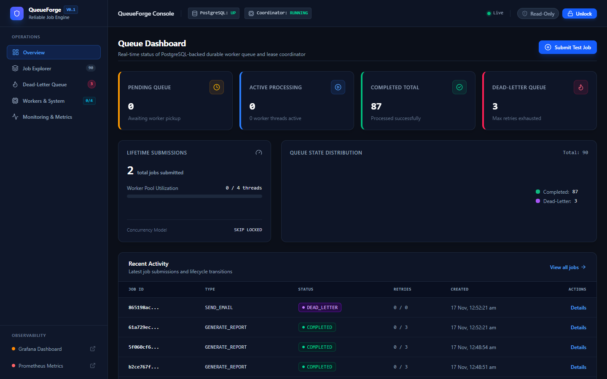

# QueueForge V2 — Portfolio Screenshot Inventory & Capture Checklist

**Document Identifier:** `QF-PORTFOLIO-SCREENSHOT-CHECKLIST`  
**Classification:** Visual Asset Management & Capture Guidelines  
**Asset Directory:** `docs/screenshots/`  

---

## 1. Verified Existing Authentic Screenshot Inventory

QueueForge V2 already contains **9 authentic, high-resolution screenshots** captured from the live Obsidian Pulse dark-mode operational dashboard:

| Filename | Resolution | Dimensions | Primary UI Component / View Featured |
| :--- | :---: | :---: | :--- |
| **`01_overview_dashboard.png`** | 99 KB | 1440 x 900 | **Mission Control Overview HUD:** Metric cards (Throughput, Active Workers, Queue Depth, DLQ count), cluster health badge, and recent activity feed. |
| **`02_job_explorer.png`** | 58 KB | 1440 x 900 | **Job Explorer Data Table:** Status filter dropdown, search input, pagination controls, priority badges, and tenant attributions. |
| **`03_job_detail_masked.png`** | 75 KB | 1440 x 900 | **Job Detail Drawer (Public Demo Mode):** Masked payload display (`*** MASKED IN DEMO MODE ***`), execution timing metadata, and attempt logs. |
| **`04_admin_unlock_modal.png`** | 95 KB | 1440 x 900 | **Admin Unlock Dialog:** Secure admin key entry modal with CSRF protection and session authentication explanation. |
| **`05_job_detail_unlocked.png`** | 72 KB | 1440 x 900 | **Job Detail Drawer (Authenticated Mode):** Fully unlocked JSON payload inspection, error stack trace, and operational replay buttons. |
| **`06_dead_letter_queue.png`** | 77 KB | 1440 x 900 | **Dead-Letter Queue (DLQ) Console:** Failed job listings, failure classification tags (`TRANSIENT_FAILURE` vs `PERMANENT_FAILURE`), and single-click replay action. |
| **`07_workers_health.png`** | 86 KB | 1440 x 900 | **Worker Fleet Telemetry:** Multi-instance worker heartbeat table (`worker-1`, `worker-2`), active job meters, and instance uptime gauges. |
| **`08_monitoring_metrics.png`** | 79 KB | 1440 x 900 | **System Telemetry & Charts:** Real-time queue latency distribution, throughput histograms, and error rate telemetry. |
| **`09_mobile_responsive_view.png`** | 31 KB | 390 x 844 | **Mobile Viewport (Pixel 5 / iPhone):** Responsive vertical layout, collapsed navigation drawer, and touch-friendly metric cards. |

---

## 2. Visual Quality Standards & Best Practices

When embedding or updating screenshots in `README.md` or portfolio sites:
1. **Authenticity Policy:** Every screenshot must be an authentic capture rendered by the browser from running application code. **Never fabricate simulated UI mockups or fake graphic assets.**
2. **Resolution & Aspect Ratio:**
   - Standard desktop captures: 1440x900 or 1920x1080 (16:10 or 16:9).
   - Mobile viewports: 390x844 (standard modern smartphone viewport).
3. **Theme & Styling:** Maintain the Obsidian Pulse dark-mode aesthetic (background `#090D16`, cards `#111827`, accent `#3B82F6` and `#10B981`).
4. **Data Hygiene:** Ensure seeded mock data (tenants, jobs, customer IDs) uses synthetic, realistic names (e.g., `tenant-enterprise-alpha`, `order-payment-uuid`) with zero personal, live API, or proprietary data.
5. **Image Compression:** Compress PNGs to under 150 KB using lossless PNG compression (e.g., `pngquant` or `oxipng`) to ensure rapid page load on GitHub.

---

## 3. Optional Additional Views Capture Checklist

The following two views are documented in the frontend routes and may be captured in future manual recording sessions:

- [ ] **FairShare Multi-Tenant View:**
  - Route: `/fairshare`
  - Elements: Tenant weight progress bars, `max_concurrency` quota meters, deficit counters, and noisy-neighbor isolation indicators.
  - Recommended filename: `docs/screenshots/10_fairshare_scheduler.png`
- [ ] **Event Pipeline / Outbox View:**
  - Route: `/outbox` or `/event-pipeline`
  - Elements: Transactional outbox events list, idempotency keys, payment delivery status (`DELIVERED`), and payment charge references.
  - Recommended filename: `docs/screenshots/11_event_pipeline_outbox.png`

---

## 4. GitHub Markdown Relative Embedding Guide

In `README.md`, always reference images using relative paths:
```markdown

```
Do not use `file:///` URLs or hardcoded local Windows drive letters (`D:\Projects\...`) in GitHub documentation.
