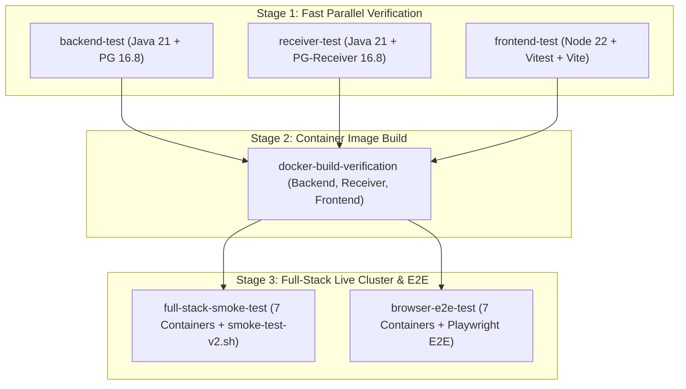
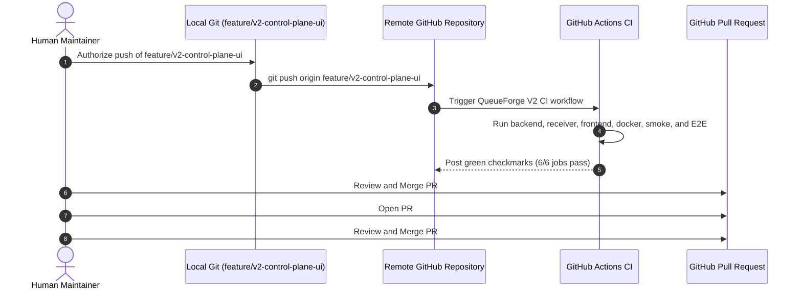

# QueueForge Phase 9A — Cloud CI Validation Plan

**Specification Version:** V2.1  
**Target Branch:** `feature/v2-control-plane-ui`  
**Anchor Base Commit:** `7125821`  
**Author:** Principal Full-Stack Engineer, Senior DevOps Engineer & Security Architect  
**Date:** November 19, 2026  

---

## 1. Overview & Cloud CI Objectives

Because the development workstation operates under physical memory boundaries (~7.3 GB RAM total with ~1.1 GB free), local execution of the complete 7-container Docker Compose cluster and live PostgreSQL databases is safely constrained.

This document establishes the **Cloud CI Validation Architecture** hosted on standard GitHub Actions runners (`ubuntu-latest`, 7 GB RAM, 2 vCPUs, 14 GB SSD), ensuring complete, reproducible, and automated verification of:
1. Primary Backend Integration with PostgreSQL 16 & Flyway V1–V8 migrations.
2. Independent Simulated Payment Receiver Integration with dedicated receiver PostgreSQL.
3. Frontend Obsidian Pulse quality, type safety, linting, and 44 Vitest component tests.
4. Docker container image multi-stage builds.
5. Live 7-container multi-worker cluster smoke test via `scripts/smoke-test-v2.sh`.
6. Playwright Browser E2E verification across desktop (1440px) and mobile (375px) viewports.

---

## 2. GitHub Actions CI Architecture

The workflow definition at [`.github/workflows/ci.yml`](file:///D:/Projects/QueueForge/.github/workflows/ci.yml) executes a 6-stage pipeline:



### Job Specifications

| Job Name | Runner Environment | Services / Dependencies | Memory Budget | Timeout | Commands Executed |
| :--- | :--- | :--- | :--- | :--- | :--- |
| **`backend-test`** | `ubuntu-latest` | `postgres:16.8-alpine` (port 5432) | JVM: 384M / Service: 256M | 15 min | `mvn clean test -DargLine="-XX:+UseSerialGC -Xmx384m" -B` |
| **`receiver-test`** | `ubuntu-latest` | `postgres:16.8-alpine` (port 5433) | JVM: 256M / Service: 256M | 10 min | `mvn clean test -DargLine="-XX:+UseSerialGC -Xmx256m" -B` |
| **`frontend-test`** | `ubuntu-latest` | Node.js 22 | ~512M | 10 min | `npm ci && npm run lint && npx tsc -b && npm run test && npm run build` |
| **`docker-build-verification`**| `ubuntu-latest` | Docker Buildx | ~1.5 GB | 15 min | Build `queueforge-backend:ci`, `payment-receiver:ci`, `frontend:ci` |
| **`full-stack-smoke-test`** | `ubuntu-latest` | Docker Compose V2 (7 containers) | Cluster Total: ~2.1 GB | 15 min | `docker compose up -d && bash scripts/smoke-test-v2.sh && docker compose down -v` |
| **`browser-e2e-test`** | `ubuntu-latest` | Docker Compose V2 + Playwright Chromium | ~2.8 GB Total | 15 min | `npx playwright install && npm run test:e2e` |

---

## 3. Full-Stack Multi-Worker Topology (`docker-compose.v2.yml`)

The live stack comprises seven isolated services adhering to the strict architectural rule that sender and receiver databases remain fully partitioned:

```
               ┌────────────────────────────────────────────────────────┐
               │              Frontend Reverse Proxy                    │
               │            (Nginx :80 -> Host :8088)                   │
               └───────────────────┬────────────────────────────────────┘
                                   │
                                   ▼
        ┌──────────────────────────────────────────────────────┐
        │            API Server (api-node-v2 :8085)            │
        │        Mode: API_ONLY | Submissions & Console        │
        └──────────────┬──────────────────────────────┬────────┘
                       │                              │
            ┌──────────▼───────────┐      ┌───────────▼──────────┐
            │  Worker Node 1 :8086 │      │  Worker Node 2 :8087 │
            │  Mode: WORKER_ONLY   │      │  Mode: WORKER_ONLY   │
            │  Claim, Fence, Relay │      │  Concurrent Claims   │
            └──────────┬───────────┘      └───────────┬──────────┘
                       │                              │
        ┌──────────────┴──────────────────────────────┴────────┐
        │        Primary Sender DB (qf-v2-sender-db)           │
        │        Port: 5432 | DB: queueforge | User: qf_app    │
        │        Tables: qf_jobs, qf_worker_heartbeats, outbox │
        └──────────────────────────────────────────────────────┘

        ────────────────────────────────────────────────────────
        [INDEPENDENT SECURITY BOUNDARY: PAYMENT RECEIVER NETWORK]
        ────────────────────────────────────────────────────────

            ┌──────────────────────────────────────────┐
            │   Payment Receiver (qf-v2-receiver :8098)│
            │   Service Key Auth & Durable Inbox       │
            └────────────────────┬─────────────────────┘
                                 │
            ┌────────────────────▼─────────────────────┐
            │  Independent Receiver DB (receiver-db)   │
            │  Port: 5432 | DB: queueforge_receiver    │
            │  Tables: charges, inbox_deduplication    │
            └──────────────────────────────────────────┘
```

---

## 4. Smoke Test Execution (`scripts/smoke-test-v2.sh`)

The script executes 8 noninteractive verification stages with zero false positives:
1. **Reverse Proxy Health:** Polls `http://127.0.0.1:8088/health` until HTTP 200 is confirmed.
2. **Authentication & Session:**
   - Submits invalid admin key -> verifies HTTP 401 Unauthorized.
   - Submits valid admin key -> verifies HTTP 200, captures `QF_SESSION` cookie and `X-CSRF-Token`.
   - Checks session status via `GET /api/v1/auth/session` -> verifies `authenticated: true`.
3. **Multi-Tenant Provisioning:** Registers `tenant-ci-alpha` (weight 2, concurrency 2) and `tenant-ci-beta` (weight 1, concurrency 1) via authenticated `POST /api/v1/admin/tenants`.
4. **End-to-End Job Processing:** Submits job with tenant key, polls for worker claim, verifies transition to `COMPLETED`, and asserts real worker attribution in `qf_job_execution_logs`.
5. **Cross-Tenant Isolation:** Asserts cross-tenant read returns HTTP 404, identity spoofing returns HTTP 403, and invalid keys return HTTP 401.
6. **Worker Fleet Discovery:** Queries `GET /api/v1/system/workers` and verifies both `worker-v2-node-1` and `worker-v2-node-2` report `ONLINE` with fresh heartbeats.
7. **Transactional Outbox & Receiver Idempotency:** Submits an order, observes outbox event pickup, confirms HTTP relay to payment receiver, verifies order transitions to `PAID`, and re-submits duplicate charge to assert `idempotentReplay: true` without duplicate ledger entries.
8. **Multi-Worker Concurrency Burst:** Submits 6 burst jobs and asserts both worker JVM instances actively participate in execution.

---

## 5. Playwright Browser E2E Test Suite (`frontend/e2e/control-plane.spec.ts`)

Covers 10 core user journeys:
- **Flow 1:** Overview Page & Mission Control KPI display.
- **Flow 2:** Admin Unlock Modal (empty validation, password show/hide toggle, key entry, unlock).
- **Flow 3:** Job Explorer table, search toolbar, status pills.
- **Flow 4:** Worker Fleet node cards and lease attribution.
- **Flow 5:** FairShare Multi-Tenant deficit counters and scheduler quotas.
- **Flow 6:** Transactional Event Pipeline outbox explorer.
- **Flow 7:** Reliability Lab resilience mechanisms and 9 formal invariants.
- **Flow 8:** Dead-Letter Queue triage and poison job inspection.
- **Flow 9:** Administration session control and security metrics.
- **Flow 10:** Obsidian Pulse dark/light theme switching.

---

## 6. Secure Test Credential Setup

In accordance with strict security standards:
- **Default Key Prohibition:** In production profiles (`-Dspring.profiles.active=prod`), `AdminProperties.java` throws `IllegalStateException` if `ADMIN_API_KEY` is empty, blank, or equals `qf_admin_dev_secret_2026`.
- **CI Test Secrets:** CI injects dynamic high-entropy test keys via environment variables:
  - `ADMIN_API_KEY: qf_v2_release_candidate_admin_key_2026`
  - `RECEIVER_SERVICE_KEY: qf_v2_internal_service_key_2026`
  - `DB_PASSWORD: ci_test_password`
- **Zero Log Leakage:** Neither secrets nor full credentials are printed in console logs or artifacts.

---

## 7. Recommended Publishing & Verification Workflow


