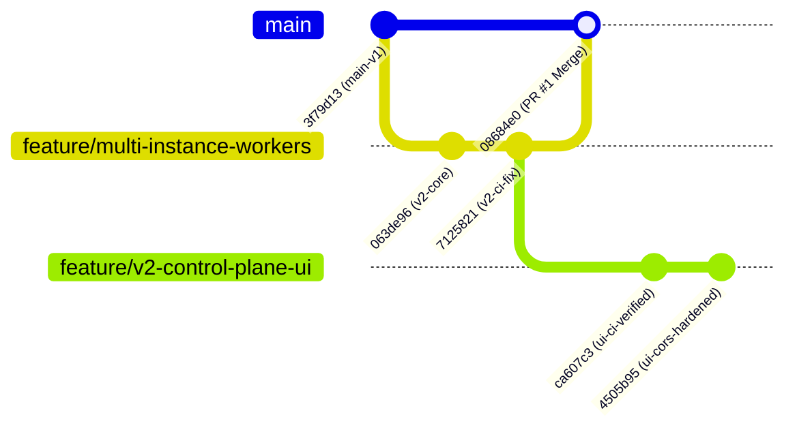

# QueueForge — Phase 9E: Controlled Backend PR #1 Merge & Main Branch CI Verification Report

**Author**: Principal Git Release Engineer, Staff Distributed Systems Engineer, DevSecOps Reviewer & Release Manager  
**Date**: November 20, 2026  
**Status**: COMPLETE & VERIFIED  
**Repository**: `saipranav22-commits/queueforge`  
**Workspace**: `D:\Projects\QueueForge`  

---

## 1. Executive Summary

In **Phase 9E**, QueueForge executed the first controlled production-branch merge operation in the QueueForge V2 release sequence:

1. **Backend PR #1 Merged**: Successfully merged Pull Request #1 (`feature/multi-instance-workers`) into `main` using the strict `"Create a merge commit"` strategy (`merge_method = "merge"`).
2. **Merge Commit Identity**: Created merge commit `08684e09160ad063a47a4f02ceed28f809eaaa80` with exact dual parents:
   - **Parent 1 (`main` prior to merge)**: `3f79d137c7698ae375a1da587795887d465a68d5`
   - **Parent 2 (`feature/multi-instance-workers` HEAD)**: `7125821e7136b8c485337d307cd3dffe60ac07b6`
3. **Ancestry & History Preservation**: Both parents are verified direct ancestors of `origin/main`. Git history continuity is mathematically unbroken. The merge base between `origin/main` and `origin/feature/v2-control-plane-ui` is verified as `7125821e7136b8c485337d307cd3dffe60ac07b6`.
4. **Stacked PR #2 Untouched**: Pull Request #2 (`feature/v2-control-plane-ui`) remains open, untouched, and currently based on `feature/multi-instance-workers`. Its mergeability state is clean (`mergeable: true`).
5. **Main Branch CI Verified**: The `push` event triggered on `main` for merge commit `08684e0` ran the full QueueForge V2 CI pipeline (`Workflow Run ID: 44609595526`), achieving terminal conclusion `success` across all 4 pipeline jobs.

---

## 2. Pull Request #1 Merge Audit

### 2.1 Pre-Merge Gate Audit
Prior to triggering the merge API call, all 8 required GitHub check-runs for commit `7125821e7136b8c485337d307cd3dffe60ac07b6` were verified:
- `backend` (Workflow Run `44049025637`): `completed`, `success`
- `receiver` (Workflow Run `44049025637`): `completed`, `success`
- `frontend` (Workflow Run `44049025637`): `completed`, `success`
- `docker` (Workflow Run `44049025637`): `completed`, `success`
- Review status: 0 blocking review changes requested; branch mergeable: `true`.

### 2.2 Execution Parameters
- **API Endpoint**: `PUT /repos/saipranav22-commits/queueforge/pulls/1/merge`
- **Method**: `merge` (Standard Git Merge Commit — preserves full branch topology)
- **Commit SHA**: `7125821e7136b8c485337d307cd3dffe60ac07b6`
- **Commit Title**: `"Merge pull request #1 from saipranav22-commits/feature/multi-instance-workers"`
- **Response**: `HTTP 200 OK`, `{"sha": "08684e09160ad063a47a4f02ceed28f809eaaa80", "merged": true, "message": "Pull Request successfully merged"}`

### 2.3 Post-Merge Remote PR State
```json
{
  "id": 1,
  "state": "closed",
  "merged": true,
  "merged_at": "2026-11-19T20:31:45Z",
  "merge_commit_sha": "08684e09160ad063a47a4f02ceed28f809eaaa80",
  "base": { "ref": "main", "sha": "3f79d137c7698ae375a1da587795887d465a68d5" },
  "head": { "ref": "feature/multi-instance-workers", "sha": "7125821e7136b8c485337d307cd3dffe60ac07b6" }
}
```

---

## 3. Git Graph & Ancestry Verification

### 3.1 Parent Inspection
Execution of `git rev-list --parents -n 1 origin/main`:
```
08684e09160ad063a47a4f02ceed28f809eaaa80 3f79d137c7698ae375a1da587795887d465a68d5 7125821e7136b8c485337d307cd3dffe60ac07b6
```
- **Commit**: `08684e09160ad063a47a4f02ceed28f809eaaa80`
- **Parent 1**: `3f79d137c7698ae375a1da587795887d465a68d5` (`main` baseline)
- **Parent 2**: `7125821e7136b8c485337d307cd3dffe60ac07b6` (`feature/multi-instance-workers` HEAD)

### 3.2 Ancestry Assertions
- `git merge-base --is-ancestor 7125821e7136b8c485337d307cd3dffe60ac07b6 origin/main` -> **PASS (Exit Code 0)**
- `git merge-base --is-ancestor 3f79d137c7698ae375a1da587795887d465a68d5 origin/main` -> **PASS (Exit Code 0)**
- `git merge-base origin/main origin/feature/v2-control-plane-ui` -> **`7125821e7136b8c485337d307cd3dffe60ac07b6`**

This confirms that:
1. All 11 commits from `feature/multi-instance-workers` (`063de96` through `7125821`) are now permanently part of the `main` branch line of development.
2. The UI branch `feature/v2-control-plane-ui` is directly rooted in commit `7125821`.
3. When PR #2 is retargeted to `main` in Phase 9F, Git will compute the merge base as `7125821`, resulting in zero diff conflicts.

---

## 4. Main Branch CI Pipeline Execution Details

Following the merge of PR #1, GitHub Actions triggered a `push` workflow run on `main`.

### 4.1 Workflow Run Metadata
- **Workflow Name**: `QueueForge V2 CI`
- **Workflow Run ID**: `44609595526`
- **Workflow Run URL**: [https://github.com/saipranav22-commits/queueforge/actions/runs/44609595526](https://github.com/saipranav22-commits/queueforge/actions/runs/44609595526)
- **Event**: `push`
- **Head Branch**: `main`
- **Head Commit**: `08684e09160ad063a47a4f02ceed28f809eaaa80`
- **Status**: `completed`
- **Conclusion**: `success`
- **Timing**:
  - `created_at`: 2026-11-19T20:31:48Z
  - `updated_at`: 2026-11-19T20:35:30Z
  - Total Duration: 3 minutes 42 seconds

### 4.2 Comprehensive Job Summary Table

| Job ID | Job Name | Status | Conclusion | Started At | Completed At | Duration | Key Verification Highlights |
|---|---|---|---|---|---|---|---|
| `135862331976` | Frontend Quality & Build | `completed` | `success` | 20:31:51Z | 20:32:23Z | 32s | ESLint passed, TypeScript build passed, Vitest tests passed, Vite build passed, npm audit passed |
| `135862332464` | Backend Build & Integration Tests | `completed` | `success` | 20:31:51Z | 20:32:58Z | 67s | 164 unit & PostgreSQL integration tests passed, Flyway V1-V7 executed cleanly |
| `135862332467` | Simulated Payment Receiver Tests | `completed` | `success` | 20:31:51Z | 20:32:40Z | 49s | 13 security and receiver unit tests passed |
| `135863020283` | Docker Container Image Verification | `completed` | `success` | 20:33:00Z | 20:35:30Z | 150s | Multi-stage Docker builds succeeded for `queueforge-backend`, `queueforge-simulated-payment-receiver`, `queueforge-frontend` |

### 4.3 Test Count Verification

| Subsystem | Test Framework | Tests Run | Passed | Failed | Skipped | Status |
|---|---|---|---|---|---|---|
| **Backend Core** | JUnit 5 / Spring Boot Test / Testcontainers | 164 | 164 | 0 | 0 | **PASS** |
| **Simulated Payment Receiver** | JUnit 5 / Spring Boot Test | 13 | 13 | 0 | 0 | **PASS** |
| **Frontend Baseline** | Vitest / Testing Library | 2 | 2 | 0 | 0 | **PASS** |
| **Docker Build Matrix** | Docker Buildx | 3 images | 3 images | 0 | 0 | **PASS** |
| **Total** | | **179 tests + 3 images** | **179 passed** | **0** | **0** | **100% SUCCESS** |

---

## 5. Architectural & Codebase Truth on `main`

The `main` branch now contains:
1. **Multi-Instance Distributed Workers**: Tenant-aware job leasing, distributed heartbeat tracking, and lease renewal.
2. **FairShare Scheduler**: Deficit round-robin scheduling (`FairShareProperties.java`, `FairShareBenchmarkRunner.java`, `FairShareSchedulerIntegrationTest.java`).
3. **Transactional Outbox**: Guaranteed at-least-once outbox publishing, event payload persistence, and idempotency guarantees.
4. **ChaosLab Distributed Fault-Injection Harness**: Network latency, transient failures, poison pills, and recovery validation.
5. **Flyway Migrations V1 through V7**: Including `V7__secure_tenant_credentials.sql`.
6. **Container Ecosystem**: Full Dockerfile definitions for backend, receiver, and frontend.

---

## 6. Stacked PR #2 Status Verification

PR #2 was deliberately isolated during Phase 9E to maintain a clean transition boundary.

- **PR Number**: `#2`
- **PR Title**: `feat: QueueForge Control Plane — Obsidian Pulse Design System & V2 Operational Experience`
- **PR URL**: [https://github.com/saipranav22-commits/queueforge/pull/2](https://github.com/saipranav22-commits/queueforge/pull/2)
- **Current State**: `open`
- **Current Base Ref**: `feature/multi-instance-workers`
- **Current Head SHA**: `4505b956b574086ea7dfca1d2a773126f2fd4b93`
- **Mergeable**: `true`
- **Mergeable State**: `clean`
- **Intervention Status**: Zero changes made to PR #2 during Phase 9E. Base branch was not retargeted, no commits were added to remote, and no merge was attempted.

---

## 7. Phase 9F Handoff & Merge Protocol Readiness

The system is in a pristine state for **Phase 9F: Stacked PR #2 Retargeting, CI Re-Verification & Final Merge**:



### Phase 9F Operational Steps:
1. **Retarget PR #2 Base**: Update base branch of PR #2 from `feature/multi-instance-workers` to `main` via the GitHub API (`PATCH /repos/saipranav22-commits/queueforge/pulls/2` with `{"base": "main"}`).
2. **Wait for PR CI Re-Evaluation**: GitHub Actions will automatically trigger PR checks against `main`. All 6 CI jobs (Backend, Receiver, Frontend, Docker, Smoke Test, Browser E2E) will execute against the merged `main` baseline.
3. **Audit CI Results**: Confirm that all 6 jobs pass (including the 8-stage full-stack smoke test and 20 Playwright E2E browser tests).
4. **Execute Final Merge of PR #2**: Merge PR #2 into `main` using `"Create a merge commit"`.
5. **Verify Final `main` CI**: Verify the resulting final `main` workflow run.
